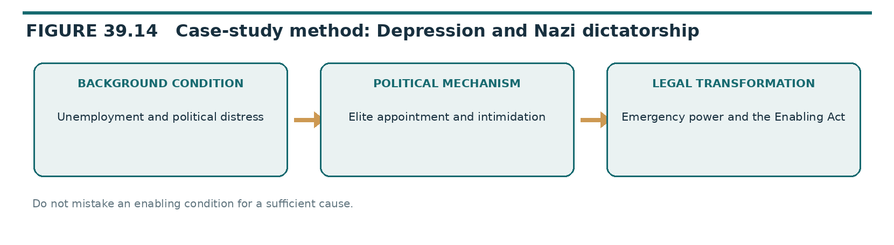

Да предположим, че някой твърди, че катастрофата през 1929 г. е предизвикала Хитлер да стане диктатор. Твърдението съдържа решаваща истина, но опростява няколко стъпки. Икономическият колапс увеличи безработицата и засили крайните партии; нацистката избирателна подкрепа се повиши рязко след 1929 г. Но Хитлер не е избран за диктатор с мнозинство. Президентът Хинденбург го назначава за канцлер през януари 1933 г. след елитно политическо договаряне. Нацисткото насилие, извънредните укази, заплахите около изборите през март и Закона за включване помогнаха да се унищожи конституционното правителство. Депресията беше основно условие, което не е достатъчно обяснение. \[<a href="/039-the-interwar-world/sources/#source-12" class="cite">12</a>\]\[<a href="/039-the-interwar-world/sources/#source-13" class="cite">13</a>\]\[<a href="/039-the-interwar-world/sources/#source-23" class="cite">23</a>\]

Тествайте това твърдение чрез сравняване на случаи: Защо Великобритания или Швеция не следват един и същ път? Защо Италия стана фашистка преди депресията? Защо елитните решения в Германия имат значение през януари 1933 г.? Отличителна корелация, фонов натиск, политически механизми и правни стъпки. Това е навикът, който въведохме в глава 1: обяснението е по-силно, когато става дума за резултати и надеждни алтернативи, вместо да избираме един драматичен факт и да го наричаме цялата причина.

<figure class="figure" id="figure-39-14">

<figcaption>Фигура 39.14. Метод на проучване: Депресия и нацистка диктатура. Не бъркайте условията с достатъчна причина. <a class="figure-anchor" href="#figure-39-14" aria-label="Link to this figure">#</a></figcaption>
</figure>
