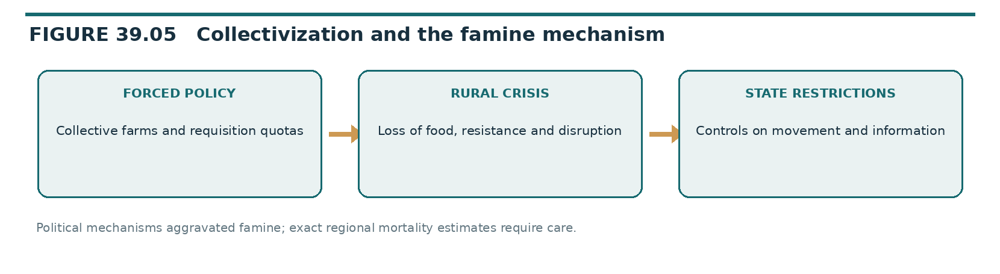

Колекционерството имаше за цел да реорганизира селските ферми в държавни колективни структури и да контролира селскостопанските поръчки. Съпротива, конфискация, депортиране, нереалистични квоти и принуда опустошиха селските общности. През 1932 и 1933 г. катастрофален глад порази Украйна и други съветски региони, включително Казахстан и части от Русия. Украинската катастрофа е известна като Холодор. Ученически демографските реконструкции се различават и смъртните случаи винаги трябва да определят техния географски и методологически обхват; милиони загинаха. \[<a href="/039-the-interwar-world/sources/#source-20" class="cite">20</a>\]\[<a href="/039-the-interwar-world/sources/#source-21" class="cite">21</a>\]

Съществуват силни доказателства, че сталинистката политика е причинила и влошила глада чрез принудителна събираемост, обществени поръчки, ограничения на движението и потискане на информацията. Учените се различават от точния момент на лидерските намерения и характеризирането на конкретни политики като специално насочен геноцид; Украйна и много правителства признават Холодора за геноцид. Представянето на този спор отговорно не изисква нито да се преструваме, че нямаме намерение, нито да приемем, че всеки въпрос от архива е решен. Реквизицията на зърното и бюрократичната принуда не бяха инциденти на времето. Политическа сила, която може да яде и кой може да си тръгне. \[<a href="/039-the-interwar-world/sources/#source-21" class="cite">21</a>\]\[<a href="/039-the-interwar-world/sources/#source-22" class="cite">22</a>\]

<figure class="figure" id="figure-39-5">

<figcaption>Фигура 39.5. Колективизация и механизъм за глад. Политическите механизми утежняват глада; точните оценки на смъртността в региона изискват грижи. <a class="figure-anchor" href="#figure-39-5" aria-label="Link to this figure">#</a></figcaption>
</figure>
