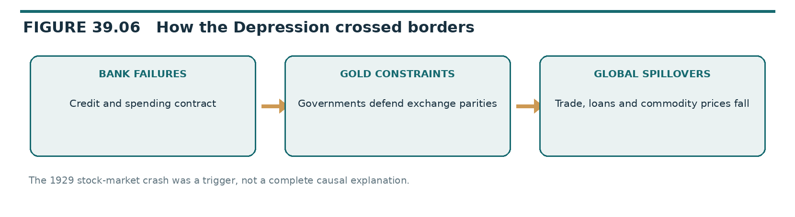

Международният златен стандарт предаде дефлационния натиск чрез обвързване на валутните и паричните избори със златни резерви и обменни ангажименти. Когато правителствата защитаваха паритетите, те често повишаваха лихвените проценти или ограничаваха кредитите дори когато безработицата растеше. Финансовите шокове са преминали през трансгранично кредитиране. Търговията се сви, докато тарифните увеличения и ответните ограничения увеличиха щетите; връзката между търговската защита и депресията беше важна, но не и еднопричинно обяснение. Великобритания остави златото през септември 1931 г., а САЩ промени монетарния си режим през 1933 г. \[<a href="/039-the-interwar-world/sources/#source-7" class="cite">7</a>\]\[<a href="/039-the-interwar-world/sources/#source-9" class="cite">9</a>\]\[<a href="/039-the-interwar-world/sources/#source-23" class="cite">23</a>\]

Времето на възстановяване варираше. Страните, които разхлабиха паричните ограничения, често се възстановяваха по-рано, въпреки че вътрешните институции, фискалната политика, банковата реформа и международното търсене също имаха значение. За Германия загубата на чуждестранни заеми и срива на заетостта се оказаха политически дестабилизиращи. Земеделските износители в Латинска Америка и колониалните икономики са имали спад в цените на суровините и свиване на приходите на правителството. Икономическата катастрофа беше глобална, но инструментите и политическото пространство, достъпни за правителствата, бяха неравномерно разпределени. \[<a href="/039-the-interwar-world/sources/#source-7" class="cite">7</a>\]\[<a href="/039-the-interwar-world/sources/#source-9" class="cite">9</a>\]

<figure class="figure" id="figure-39-6">

<figcaption>Фигура 39.6. Как депресията е прекосила границите. Катастрофата на фондовия пазар през 1929 г. е била спусък, а не пълно обяснение на причините. <a class="figure-anchor" href="#figure-39-6" aria-label="Link to this figure">#</a></figcaption>
</figure>
