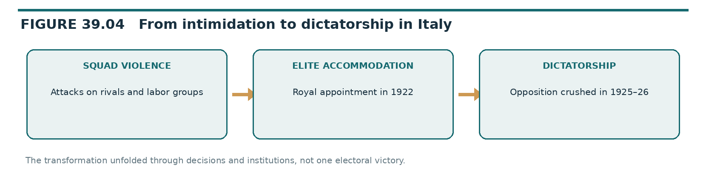

Италия се е борила на печелившата страна през Първата световна война, но безработицата, трудовият конфликт, ветеранските оплаквания, страховете от революция и споровете за териториални награди отслабиха либералните правителства. Фашисткото движение на Бенито Мусолини организира насилствени отряди, които атакуваха социалисти, профсъюзи и опоненти. Някои земевладелци, работодатели и консервативни фигури толерират или подкрепят отборите като защита срещу левите. Така нареченият март на Рим през октомври 1922 г. включва натиск и мобилизация, но Мусолини е назначен за министър-председател от крал Виктор Емануел III, вместо да спечели власт чрез традиционно мнозинство избори. \[<a href="/039-the-interwar-world/sources/#source-17" class="cite">17</a>\]

Една диктатура се оформяла на етапи. След убийството през 1924 г. на депутата от социалистите Джакомо Матеоти, фашистките лидери са изправени пред криза; през 1925г.1926г. Мусолини разглобява голяма част от оставащата политическа опозиция и свободната преса. Фашизмът изгражда масови организации, цензура, полицейски сили и култ към лидерството. Той също така преследваше агресивен национализъм и в крайна сметка колониална война. Урокът не е, че италианската държава просто рухна в един драматичен уикенд: институциите, политическите елити, организираното насилие и изчисленото настаняване помогнаха за превръщането на парламентарно назначение в диктатура. \[<a href="/039-the-interwar-world/sources/#source-17" class="cite">17</a>\]\[<a href="/039-the-interwar-world/sources/#source-18" class="cite">18</a>\]

<figure class="figure" id="figure-39-4">

<figcaption>Фигура 39.4. От заплахи до диктатура в Италия. Преобразуването се разгърна чрез решения и институции, нито една изборна победа. <a class="figure-anchor" href="#figure-39-4" aria-label="Link to this figure">#</a></figcaption>
</figure>
