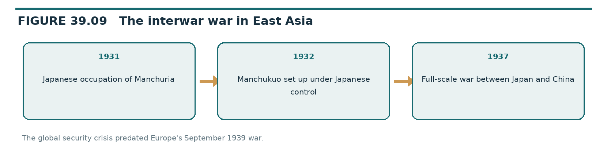

Япония влезе в междувоенната ера като индустриална и имперска власт с официални парламентарни институции, мощно военно заведение и разширяващ се интерес към Корея и Китай. Цивилните правителства, управлявани под ограничения, и военните офицери все повече следваха политики извън ефективния партиен контрол. През септември 1931 г. японски офицери организирали инцидент на южната манджурска железница и го използвали като претекст за окупиране на Манджурия. Кукленото състояние на Манчукуо е създадено през 1932 г. \[<a href="/039-the-interwar-world/sources/#source-30" class="cite">30</a>\]

Разследването на Лигата отхвърли идеята, че новото споразумение представлява свободно местно самоопределение, но реакцията му не успя да обърне завоеванието. Япония се оттегли от Лигата след критики. През 1937 г. избухна война с пълен мащаб между Япония и Китай след подновени битки близо до Пекин. Конфликтът се разширява до масово насилие срещу цивилни лица, включително зверства по време на залавянето на Нанджинг. Тези събития показват защо книга, организирана около европейските войни, не трябва да третира Азия като просто далечен театър в очакване на 1941 г. Международният ред вече се разпадаше в Източна Азия. \[<a href="/039-the-interwar-world/sources/#source-5" class="cite">5</a>\]\[<a href="/039-the-interwar-world/sources/#source-30" class="cite">30</a>\]

<figure class="figure" id="figure-39-9">

<figcaption>Фигура 39.9. Междувоенната война в Източна Азия. Световната криза в областта на сигурността предизвика войната в Европа през септември 1939 г. <a class="figure-anchor" href="#figure-39-9" aria-label="Link to this figure">#</a></figcaption>
</figure>
