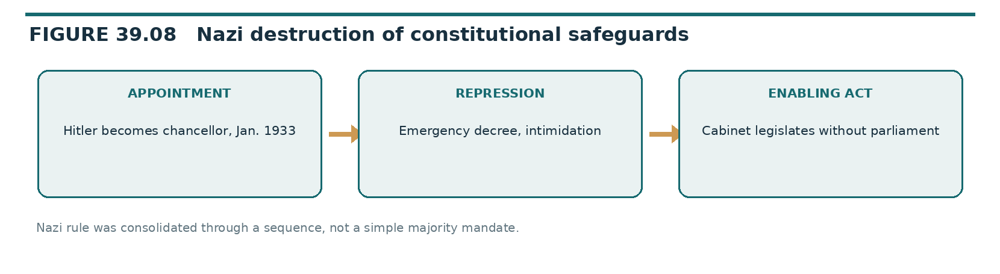

Нацистката идеология определяла нацията чрез расова йерархия и представяла евреите като измислен, опасен враг. Преследването започна преди Втората световна война и ескалира чрез публични бойкоти, уволнения, изключване от професии и училища и все по-систематична правна дискриминация. Нюрнбергските закони от септември 1935 г. формализират расисткото гражданство и ограниченията на брака и взаимоотношенията. Човек може да бъде преследван не заради лична вяра или поведение, а защото държавата е класифицирала предците си според расистките правила. \[<a href="/039-the-interwar-world/sources/#source-27" class="cite">27</a>\]

На 9 и 10 ноември 1938 г., координирана вълна от антиевреинско насилие, известна като Кристалнахт опустошителни синагоги, магазини и домове, докато десетки хиляди евреи били арестувани. Погромът разкри готовността на режима да превърне масовото публично насилие в част от държавната политика. Не всеки по-късно военно време развитие е напълно решено през 1933 г., и Холокоста трябва да бъде проучен в собствената си хронология в глава 40. Но идеологическите и институционални основи на преследването вече бяха ясно видими през междувоенния период. \[<a href="/039-the-interwar-world/sources/#source-27" class="cite">27</a>\]\[<a href="/039-the-interwar-world/sources/#source-28" class="cite">28</a>\]

<figure class="figure" id="figure-39-8">

<figcaption>Фигура 39.8. Нацистко унищожаване на конституционните гаранции. Нацисткото управление беше консолидирано чрез поредица, а не чрез просто мнозинство. <a class="figure-anchor" href="#figure-39-8" aria-label="Link to this figure">#</a></figcaption>
</figure>
