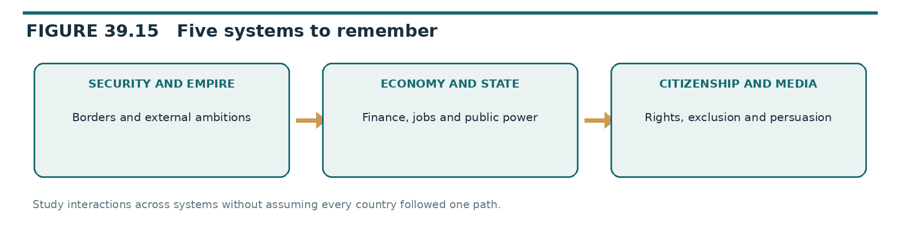

До 1939 г. бяха трансформирани пет основни системи. Международната система за сигурност загуби доверието си в основните конфронтация. Икономическата система беше претърпяла необикновен глобален срив и правителствата приеха различни средства за защита. Политическите системи показаха различни възможности: демократични иновации, военно управление, фашистка и нацистка диктатура и сталинистки еднопартиен терор. Империите са изправени пред все по-организирани антиколониални движения, докато имперската Япония и европейските сили преследват по-нататъшно разширяване. Масовите медии, образованието и културата увеличиха капацитета на обществото както за публично участие, така и за държавно убеждаване. \[<a href="/039-the-interwar-world/sources/#source-1" class="cite">1</a>\]\[<a href="/039-the-interwar-world/sources/#source-2" class="cite">2</a>\]

Имайте предвид пет въпроса: Какво се промени икономически? Кой контролира институциите на сила? Колко включваше гражданството? Какви ангажименти биха могли да изпълняват международните организации? Кои групи бяха разрешени да участват в политиката без страх? Тези въпроси свързват междувоенната история с по-късните глави за война, идеология, икономика, обществен живот и географията на властта. Няма нужда да се преструваме, че една формула обяснява всяка страна. Най-силният общ урок е да изследваме взаимодействието на системите, без да изтриваме хората, които са действали в тях.

<figure class="figure" id="figure-39-15">

<figcaption>Фигура 39.15. Пет системи за запомняне. Проучване взаимодействията между системите, без да се предполага всяка страна следва един път. <a class="figure-anchor" href="#figure-39-15" aria-label="Link to this figure">#</a></figcaption>
</figure>
