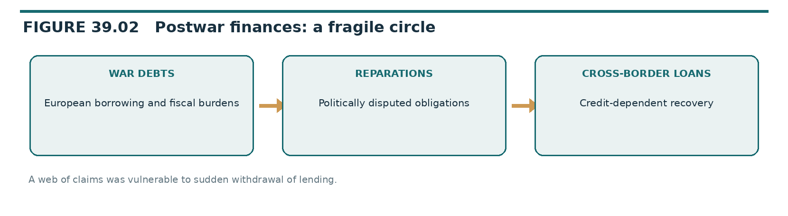

Войната също пренареди глобалното финансиране. Правителствата, взети назаем по скала, която беше трудна за поддържане; валутите изпитаха инфлация или нестабилност; а Съединените щати имаха големи претенции към европейските длъжници. Немските репарации са свързани в обществения дебат и финансовата практика с проблема с дълговете на Съюзниците, въпреки че правните задължения не са идентични. Новите държави наследиха фрагментирани железопътни линии, митнически системи, банки и пазари, които някога са преминавали през имперските граници. Мирът не връща икономическия живот в условията на 1913 г. \[<a href="/039-the-interwar-world/sources/#source-7" class="cite">7</a>\]\[<a href="/039-the-interwar-world/sources/#source-8" class="cite">8</a>\]

В някои страни завръщането на предвоенните златни парити се превърна в политическа цел. Златният стандарт обеща доверие чрез ограничаване на движението на обменните курсове, но също така ограничи централните банки, когато падащите цени и безработицата призоваваха за парична гъвкавост. Държавите са изправени пред конкурентни интереси: кредиторите искаха стабилна валута; земеделските стопани искаха по-добри цени; износителите искаха конкурентоспособност; работниците искаха работни места и покупателна способност. Възможната депресия е по-лесно да се разбере, ако тези конфликти бъдат третирани като институции и политически избори, а не само последиците от един сензационен ден на Уолстрийт. \[<a href="/039-the-interwar-world/sources/#source-7" class="cite">7</a>\]\[<a href="/039-the-interwar-world/sources/#source-9" class="cite">9</a>\]

<figure class="figure" id="figure-39-2">

<figcaption>Фигура 39.2. Следвоенни финанси: крехък кръг. Мрежа от вземания беше уязвима на внезапно оттегляне на заеми. <a class="figure-anchor" href="#figure-39-2" aria-label="Link to this figure">#</a></figcaption>
</figure>
