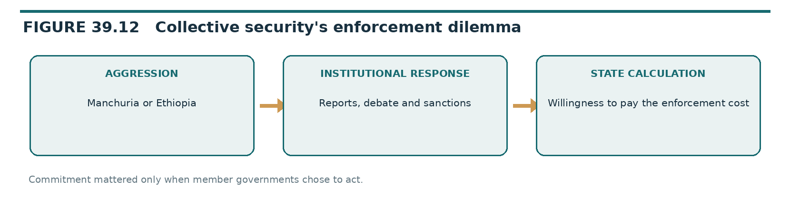

През 1930 г. нацистка Германия преследва ревизия и завоевание, превъоръжаване и подкопава европейската заповед за сигурност. През 1935 г. Германия открито отново се записала в армията и през март 1936 г. възстановила Райнланд-Пфалц. Италия нападна Етиопия; Германия и Италия развиха по-тесни отношения; Япония продължи напред в Китай. Испанската гражданска война доведе чуждестранни бойци и военна помощ в конфликт, който европейските демокрации се бореха да задържат. Международните кризи, натрупани, но редът и последиците им трябва да бъдат проследени внимателно, а не описани като един непрекъснат генерален план. \[<a href="/039-the-interwar-world/sources/#source-2" class="cite">2</a>\]\[<a href="/039-the-interwar-world/sources/#source-5" class="cite">5</a>\]

Чуждите правителства реагираха чрез смесица от протести, преговори, санкции, домашно превъплъщение и опит за настаняване. Всяко решение променяше това, което лидерите вярваха, че техните опоненти ще последват. Споменът за Първата световна война оформи общественото нежелание да се бори, и стратегически опасения на някои правителства постави под въпрос дали техните въоръжени сили са готови. Този натиск помага да се обясни поведението, но не оправдава автоматично решенията, които пожертваха сигурността на другите страни. Историческото обяснение не е същото като ретроспективното одобрение. \[<a href="/039-the-interwar-world/sources/#source-2" class="cite">2</a>\]\[<a href="/039-the-interwar-world/sources/#source-37" class="cite">37</a>\]

<figure class="figure" id="figure-39-12">

<figcaption>Фигура 39.12. Колективната дилема на сигурността. Обвързването имаше значение само когато правителствата на страните-членки избраха да действат. <a class="figure-anchor" href="#figure-39-12" aria-label="Link to this figure">#</a></figcaption>
</figure>
