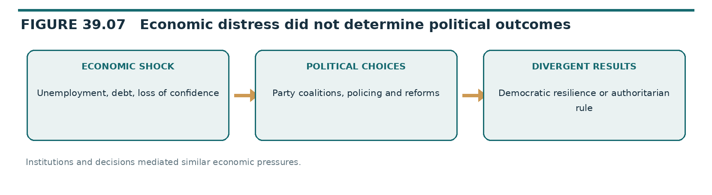

Икономическата криза отслаби установените партии и даде обещания за национално спасение емоционално мощен. Тя също така разшири аудиторията за конспиративни теории, обвинявайки външни лица, малцинства, финансисти, или изобрети вътрешни врагове. Но е погрешно да се твърди, че безработицата сама по себе си обяснява фашизма. Италианското фашистко поглъщане предшества Голямата депресия; някои страни понасят сериозни икономически затруднения, като същевременно поддържат парламентарното правителство. Политическите институции, елитите, насилието, пропагандата, историческите оплаквания и конкретни решения бяха решаващи променливи. \[<a href="/039-the-interwar-world/sources/#source-12" class="cite">12</a>\]\[<a href="/039-the-interwar-world/sources/#source-18" class="cite">18</a>\]

Едно полезно сравнение пита защо правителствата, изправени пред подобен натиск, са избрали различни пътища. Дали офицерите са останали верни на конституционната власт? Могат ли партиите да формират надеждни коалиции? Дали работодателите или земевладелците финансират антидемократични движения? Дали вестниците били независими? Бяха ли ограничени аварийните сили? Как международните задължения се отразиха на вътрешното доверие? Отговорът на тези въпроси помага да се превърне неясна история за "трудни времена" в историческо обяснение за конкурентни институции и агенции. Той също така предотвратява заблуждаващото предположение, че хората в икономически затруднения непременно предпочитат диктатурата. \[<a href="/039-the-interwar-world/sources/#source-12" class="cite">12</a>\]\[<a href="/039-the-interwar-world/sources/#source-13" class="cite">13</a>\]

<figure class="figure" id="figure-39-7">

<figcaption>Фигура 39.7. Икономическият стрес не определя политическите резултати. Институции и решения, медиирани подобен икономически натиск. <a class="figure-anchor" href="#figure-39-7" aria-label="Link to this figure">#</a></figcaption>
</figure>
