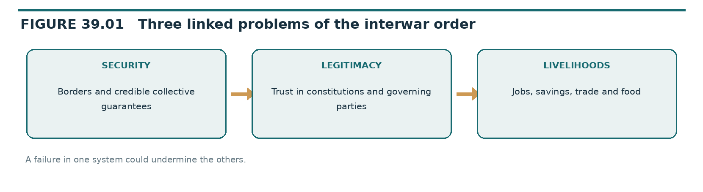

Войната е повредила три взаимно свързани основи на политическата стабилност. Сигурността е загрижена дали държавите могат да защитават границите си, без да провокират нов конфликт. Легионността се отнасяла до това дали гражданите смятали парламентите, монархиите или революционните правителства за право да управляват. Жизнените работни места, цените, земята, спестяванията и способността да се хранят едно домакинство. Дори правителство, което реши един проблем, може да се провали заради друг. Граничната гаранция струваше по-малко, ако гласоподавателите не вярваха на кабинета, който обеща да я подкрепи. Икономическото възстановяване може да бъде затрупано от нова банкова паника или преврат.

Различни региони преживяват тази криза по различен начин. Съединените щати се появиха като основен кредитор и индустриална власт. Германия стана република след имперското поражение. Австро-Унгария и Османската империя се разделиха на различни политически договорености; Руската империя бе заменена от революционна съветска държава. В Азия японските имперски амбиции и китайските борби за национално обединение породиха свои собствени конфликти. Европейските колонии в Африка и Азия видях обещания за самоопределение, прилагани избирателно. Затова историците трябва да изучават 1920-те и 30-те години като свързан свят, а не просто праисторията на нахлуването на Хитлер в Полша. \[<a href="/039-the-interwar-world/sources/#source-1" class="cite">1</a>\]\[<a href="/039-the-interwar-world/sources/#source-3" class="cite">3</a>\]

<figure class="figure" id="figure-39-1">

<figcaption>Фигура 39.1. Три свързани проблема на междувоенния ред. Провал в една система може да подкопае останалите. <a class="figure-anchor" href="#figure-39-1" aria-label="Link to this figure">#</a></figcaption>
</figure>
