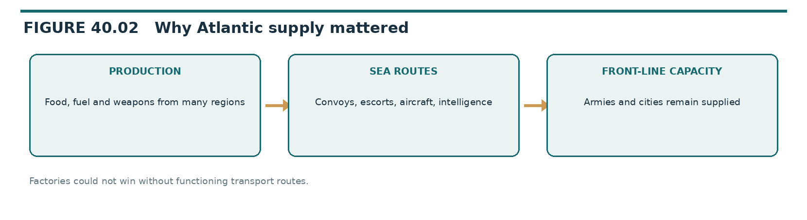

Германия търси въздушно превъзходство над Великобритания през 1940 г., докато Кралските военновъздушни сили използват радар-подкрепени ранно предупреждение, боен контрол и разширяване на усилията за производство на самолети да се съпротивляват. Битката за Британия не сложи край на опасността за цивилните. Немски бомбардировки на градове по време на Blitz убити и ранени хиляди, унищожени домове и променени ежедневието. Великобритания разчиташе на вноса на храна, петрола и военните доставки, пристигащи по море. Контролът на канала е от значение, но също така и много по-голямата битка за поддържане на Атлантик корабоплаването функционира.

Германски подводници заплашват търговски конвои; съюзнически отговори комбинирани ескорти, самолети, разузнаване, разбиване на кодове, подобряване на радара и постоянно увеличаване на корабостроенето. Битката на Атлантическия океан продължи през голяма част от войната и показва защо производството и транспорта не могат да бъдат отделени от битките. Резервоарът на фабриката е с ограничена употреба, ако не може да стигне до фронта и устойчивостта на населението във военно време се намалява, ако вносът на храна и гориво се провали. Оцеляването на Великобритания през 1940 г. също зависело от имперските ресурси и ресурсите на Федерацията. Признаването на тази подкрепа избягва намаляването на войната до решенията на няколко европейски столици. \[<a href="/040-world-war-ii-and-the-holocaust/sources/#source-3" class="cite">3</a>\]\[<a href="/040-world-war-ii-and-the-holocaust/sources/#source-7" class="cite">7</a>\]

<figure class="figure" id="figure-40-2">

<figcaption>Фигура 40.2. Защо атлантическите доставки са от значение. Фабриките не могат да спечелят без действащи транспортни маршрути. <a class="figure-anchor" href="#figure-40-2" aria-label="Link to this figure">#</a></figcaption>
</figure>
