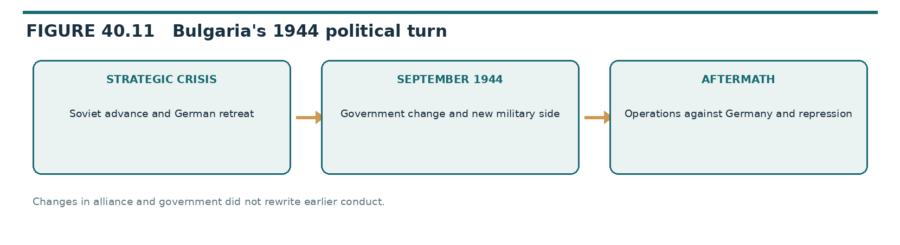

Българската военна позиция стана неустойчива, когато Германия се оттегли и Съветският съюз се приближи към Югоизточна Европа. След политически катаклизъм Съветският съюз обявява война на България през септември 1944 г. въпреки по-ранното избягване на борбата със съветските сили в България. На 9 септември превземането на Отечествения фронт, подкрепено от политически и военни актьори и присъствието на съветските сили, доведе ново правителство на власт. След това България се бори срещу Германия, включително операциите в Югославия и Унгария. Промяната във военното подравняване не премахна предишната отговорност на страната за окупационни политики или антисемитизъм по време на война.

Преходът също така откри период на прочистване, политически изпитания и бързо увеличаване на комунистическото влияние. Народният съд, създаден под ръководството на новите органи, провежда съдебни дела и екзекуции на фона на дълбоко спорни процедурни въпроси и правосъдие. След войната България запази Южна Добруджа, но загуби контрол над окупираните от времето територии. Тълкуването на септември 1944 г. като само освобождение или само окупация изтрива истински политически конфликти и различни преживявания. Внимателно трябва да се посочат военните факти, вътрешното завземане на властта, последвалите репресии и нововъзникващата съветска сфера на влияние поотделно. \[<a href="/040-world-war-ii-and-the-holocaust/sources/#source-26" class="cite">26</a>\]\[<a href="/040-world-war-ii-and-the-holocaust/sources/#source-34" class="cite">34</a>\]

<figure class="figure" id="figure-40-11">

<figcaption>Фигура 40.11. Политическият ред на България през 1944 г. Промените в съюза и управлението не са пренаписали по-ранното поведение. <a class="figure-anchor" href="#figure-40-11" aria-label="Link to this figure">#</a></figcaption>
</figure>
