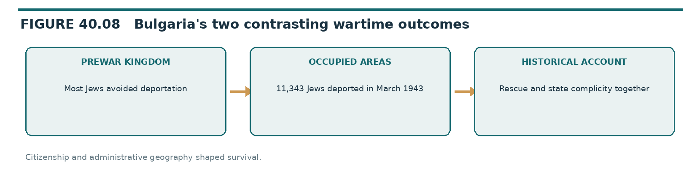

През март 1943 г. българската полиция и военни власти арестуваха и депортираха 11 334 евреи от окупираните от България територии на Вардарска Македония, Тракия и Пирот. Те бяха прехвърлени в ареста на Германия и почти всички бяха убити, много от тях в Треблинка. Това беше тежко престъпление, в което българските държавни институции играеха пряка роля. Депортирането от тези територии не трябва да се крие зад познатия разказ, че България "спасила евреите си." От значение е точно кои хора са били включени в страната преди войната и кои жители на окупираните райони са били лишени от еднаква защита.

Планираните депортирания на евреи, живеещи в предвоенните граници на България, не продължиха. Интервенцията на политиците, включително Димитър Пешев, Българското православно духовенство, някои интелектуалци, общностни мрежи и др. допринесе за съпротивата, а мотивите и ролята на крал Борис III остават предмет на исторически дебат. Повечето евреи в предвоенното царство оцелели, въпреки че издържали дискриминационни закони, принудителен труд, конфискация и вътрешно преместване. Исторически отговорно изявление е две части: значително спасяване настъпили в рамките на старото кралство, и властите са съучастници в смъртоносни депортирания от окупираната територия. Тези факти съществуват еднакво. \[<a href="/040-world-war-ii-and-the-holocaust/sources/#source-26" class="cite">26</a>\]\[<a href="/040-world-war-ii-and-the-holocaust/sources/#source-27" class="cite">27</a>\]

<figure class="figure" id="figure-40-8">

<figcaption>Фигура 40.8. Двата противоположни военни резултата на България. Гражданство и административна география оформено оцеляване. <a class="figure-anchor" href="#figure-40-8" aria-label="Link to this figure">#</a></figcaption>
</figure>
