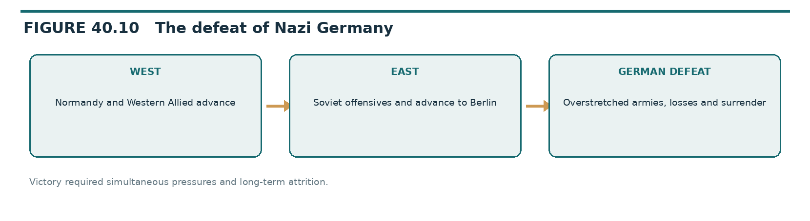

На 6 юни 1944 г. западните съюзнически сили се приземиха в Нормандия в огромна амфибия и въздушно-въздушна операция, подкрепена от самолети, кораби, инженерство, измама и планиране на доставките. Кацанията създадоха основен фронт в Северозападна Европа, но победата зависеше от скъпото бягство от Нормандия, освобождението на Париж и продължаващите операции към Германия. Френските групи за съпротива и свободните френски сили изиграха важна роля. Съюзническата стратегия трябваше да поддържа сътрудничеството между националните армии и изграждането на тръбопроводи, пристанища и пътища, способни да снабдяват прогресивни войски.

Кацанията в Нормандия бяха решаващ принос, но те не трябва да изместват съветската война на Източния фронт, борбата в Италия или годините на съпротива в окупираните страни. Различни национални възпоменания подчертават различни битки, често поради разбираеми причини за местна саможертва. Едно глобално обяснение пита как фронтовете са взаимодействали. Голямата офанзива на Червената армия през лятото на 1944 г. срещу немските сили в Беларус причини катастрофални загуби приблизително по същото време като кампанията в Нормандия. Германия трябваше да се изправи срещу големи офанзиви от различни посоки при все по-тежки ограничения на доставките. \[<a href="/040-world-war-ii-and-the-holocaust/sources/#source-3" class="cite">3</a>\]\[<a href="/040-world-war-ii-and-the-holocaust/sources/#source-32" class="cite">32</a>\]

<figure class="figure" id="figure-40-10">

<figcaption>Фигура 40.10. Поражението на нацистка Германия. Победата изискваше едновременно напрежение и дългосрочно привличане. <a class="figure-anchor" href="#figure-40-10" aria-label="Link to this figure">#</a></figcaption>
</figure>
