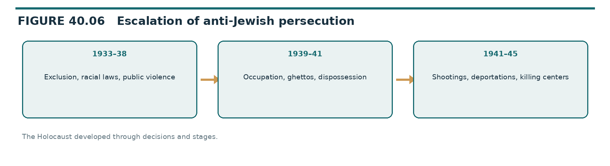

Варшавските гетота и гетата са сред най-известните примери, но нацистките власти ограничавали евреите в много окупирани градове. Семействата се бореха с недостатъчно подслон, ограничена храна, принудителна работа, епидемични болести и произволно насилие. Еврейските съвети били изправени пред принудителни административни изисквания при условия, създадени от окупаторите; техните действия не могат да бъдат оценени сякаш притежават нормален суверенитет. Контрабандата, взаимната помощ, нелегалното учение, религиозните практики и подземните архиви били действия, чрез които хората се опитвали да поддържат живота и да запазят свидетелството.

Нацистки и сътрудничещи служители са използвали разписанието на железниците, регистрационните списъци, полицейските заповеди и бюрократичните евфемизми за координиране на депортациите. На пръв поглед неутрален транспортен документ може да бъде част от процес на убиване. Бюрокрацията не намали моралната отговорност; тя разпространяваше действия в офисите, така че много хора да твърдят, че изпълняват само индивидуалната си задача. Тайният архив Oneg Shabbat, създаден в гетото на Варшава, показва защо свидетелствата са от значение: хората се опитват да съхранят очевиден запис, докато събитията все още се разгръщат, въпреки че не могат да знаят дали ще оцелеят. \[<a href="/040-world-war-ii-and-the-holocaust/sources/#source-19" class="cite">19</a>\]\[<a href="/040-world-war-ii-and-the-holocaust/sources/#source-21" class="cite">21</a>\]

<figure class="figure" id="figure-40-6">

<figcaption>Фигура 40.6. Ескалиране на антиеврейското преследване. Холокоста се развива чрез решения и етапи. <a class="figure-anchor" href="#figure-40-6" aria-label="Link to this figure">#</a></figcaption>
</figure>
