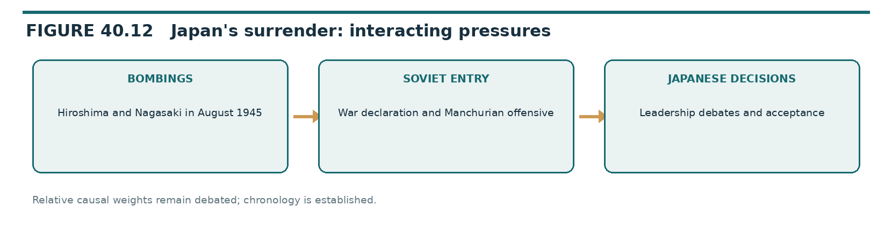

На 6 август 1945 САЩ пусна атомна бомба на Хирошима; на 9 август друг удари Nagasaki. Взривовете са убили много цивилни незабавно и изгаряния, радиация и разрушена медицинска инфраструктура са причинили още смърт. САЩ са разработили бомбите чрез обширна научна, индустриална и военна програма, известна като "Проектът Манхатън." Американските лидери твърдят, че използването им може да ускори капитулацията на Япония и да избегне още повече смъртни случаи. Други съвременни гласове и по-късно учени оспориха необходимостта, избора на цели и морала си.

Всяко твърдение, че бомбите са били единствената причина за капитулация, опростява август 1945 г. Съветският съюз обяви война на Япония на 8 август и започна голяма офанзива в Манджурия. Япония е изправена пред срутваща се стратегическа позиция, блокада, взривяване, несигурна перспектива за договорени условия и разделено ръководство. Император Хирохито обяви приемането на капитулацията в средата на август, а официални документи бяха подписани на 2 септември 1945 г. Историците не са съгласни с относителното влияние на атомните бомбардировки и съветското влизане. Това, което е установено, е поредицата от събития, опустошението на бомбардираните градове и изключителните залози на решенията. \[<a href="/040-world-war-ii-and-the-holocaust/sources/#source-16" class="cite">16</a>\]\[<a href="/040-world-war-ii-and-the-holocaust/sources/#source-35" class="cite">35</a>\]

<figure class="figure" id="figure-40-12">

<figcaption>Фигура 40.12. Японската капитулация: взаимодейства с натиска. Относителните причинни тежести остават дискутирани; хронологията е установена. <a class="figure-anchor" href="#figure-40-12" aria-label="Link to this figure">#</a></figcaption>
</figure>
