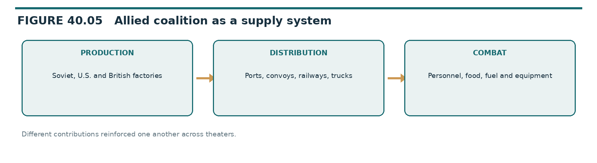

Военните коалиции са изправени пред основен проблем с координацията: всяко правителство иска победа, но има различни нужди от сигурност, идеологически ангажименти и страхове. Великобритания приоритизира оцеляването, атлантическите кораби и средиземноморската стратегия. Съветският съюз поиска натиск върху Германия в Европа, докато се бори с огромни поземлени кампании. САЩ трябваше да разпределят корабоплаването, фабриките и силите между Германия и Япония. Китай се бори за своето оцеляване и международно признание. Съюзническите конференции създадоха координация, но никога не премахнаха несъгласието относно времето, следвоенните граници или политическата легитимност.

Американският Lend-Lease изпрати автомобили, гориво, храна, метали и оборудване на съюзническите страни, докато съветските фабрики произвеждаха огромни количества оръжия и Великобритания и Федерацията поддържаха морски и въздушни операции. Логистиката е свързана с тези вноски: камионите, превозващи доставки, биха могли да променят оперативната мобилност дори когато те не са основните оръжия на снимките. Правителствата също разчитаха на колониални войници и работници, чиито политически права останаха неравностойни. Затова съюзническите военни усилия бяха коалиция от държавни интереси и човешки приноси, а не монолитна армия, която напредваше под една единна идеология. \[<a href="/040-world-war-ii-and-the-holocaust/sources/#source-3" class="cite">3</a>\]\[<a href="/040-world-war-ii-and-the-holocaust/sources/#source-18" class="cite">18</a>\]

<figure class="figure" id="figure-40-5">

<figcaption>Фигура 40.5. Съюзническа коалиция като снабдителна система. Различните приноси се укрепват взаимно в различни театри. <a class="figure-anchor" href="#figure-40-5" aria-label="Link to this figure">#</a></figcaption>
</figure>
