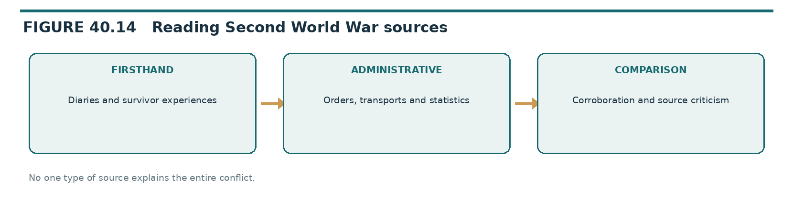

Втората световна война генерира заповеди, фотографии, частни писма, радиопредавания, разузнавателни записи, индустриална статистика, лагерни регистри и милиони спомени. Тези източници са ценни, но не са взаимозаменяеми. Официалното комюнике може да покаже какво е искало правителството да вярва, а не какво всъщност се е случило на бойното поле. Акаунтите на оцелелия са изживели опит, докато естествено отразяват една ограничена точка на наблюдение. Масата за производство на оръжие може да измери производството, но не и да обясни глада на цивилните. Сравнението между независими видове доказателства е от съществено значение.

Историческите дебати за стратегически бомбардировки, разузнаване, военно ръководство и дипломатически решения са законни, когато те се възползват от доказателства. Отричането на Холокоста и изфабрикуваните твърдения за невинност във военно време не са просто алтернативни "опиони" на равнопоставена позиция. Те пренебрегват огромната документация или селективно потискат жертвите и действията на извършителите. Публичната памет може да се изкриви и без умишлено отричане, когато националните възпоменания изключват непопулярни епизоди на сътрудничество или престъпления. Добрата историческа практика запазва постиженията на съпротивата, докато се сблъсква с неуспехите на властите и обществата, включително и собствените. \[<a href="/040-world-war-ii-and-the-holocaust/sources/#source-19" class="cite">19</a>\]\[<a href="/040-world-war-ii-and-the-holocaust/sources/#source-20" class="cite">20</a>\]

<figure class="figure" id="figure-40-14">

<figcaption>Фигура 40.14. Четем източници от Втората световна война. Никой източник не обяснява конфликта. <a class="figure-anchor" href="#figure-40-14" aria-label="Link to this figure">#</a></figcaption>
</figure>
