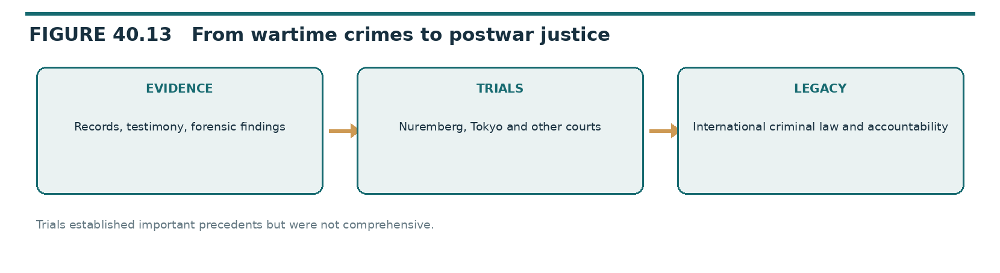

След поражението на силите на Оста, международните и националните съдилища осъдиха някои висши длъжностни лица и други извършители. Международният военен трибунал в Нюрнберг разглежда престъпления срещу мира, военните престъпления и престъпленията срещу човечеството; по-късно производствата разследваха лекари, съдии, индустриалци и допълнителни обвиняеми. Токийският трибунал и други съдебни процеси се считат за японски лидери и зверства във военно време в Азия. Тези правни събития създали трайни прецеденти, въпреки че били несъвършени и не преследвали всеки отговорен човек.

Критиците отбелязват, че съдилищата, свикани от победоносни сили, не могат напълно да избегнат проблема със избирателното правосъдие. Въпреки това съдебните процеси документираха огромни количества доказателства и установиха, че официалните или държавните заповеди не премахват автоматично лична престъпна отговорност. По-късно правните категории се развиват чрез нови конвенции и институции, включително Конвенцията от Геноцид от 1948 г. Следователно преследването на правосъдие е било както незабавен отговор на престъпленията, така и началото на още много по-продължителен спорен опит за ефективно прилагане на международното наказателно право. \[<a href="/040-world-war-ii-and-the-holocaust/sources/#source-20" class="cite">20</a>\]\[<a href="/040-world-war-ii-and-the-holocaust/sources/#source-33" class="cite">33</a>\]

<figure class="figure" id="figure-40-13">

<figcaption>Фигура 40.13. От военни престъпления до следвоенно правосъдие. Съдебните процеси установиха важни прецеденти, но не бяха цялостни. <a class="figure-anchor" href="#figure-40-13" aria-label="Link to this figure">#</a></figcaption>
</figure>
