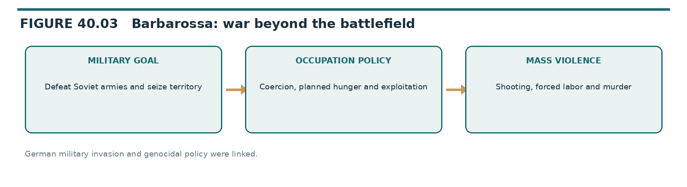

На 22 юни 1941 г. нацистка Германия и нейните съюзници атакуват Съветския съюз. Кампанията беше много повече от конвенционална гранична война. Нацисткото ръководство си представяло завладяването на източната територия за германското селище, експлоатацията на храна и ресурси, унищожаването на болшевизма и премахването или подчиняването на населението, класифицирано като расово по-ниско. Германските единици и окупационните власти извършиха масови убийства на цивилни, евреи, роми и военнопленници. Гладуването не беше просто случаен логистичен проблем; планиращите предвиждаха политики, които да отклонят храната от голямото окупирано население.

Германските армии направиха драматичен първоначален напредък и обградени съветски сили, но разстоянието, съпротивата, ограниченията на доставките, индустриалната мобилизация и времето заедно, за да се предотврати бърза победа. Съветското правителство премества фабрики на изток и мобилизира огромни човешки ресурси, често и чрез патриотични призиви и принудителни държавни мерки. Битките около Москва в края на 1941 г. приключиха с перспективата за прост ранен колапс. Този театър стана най-голямата и кървава борба в Европа, но съветският принос не може да бъде заловен от една статистика за жертвите: той включваше войници, индустриални работници, евакуирани, партизани и цивилни оцелели окупации и обсада. \[<a href="/040-world-war-ii-and-the-holocaust/sources/#source-11" class="cite">11</a>\]\[<a href="/040-world-war-ii-and-the-holocaust/sources/#source-12" class="cite">12</a>\]

<figure class="figure" id="figure-40-3">

<figcaption>Фигура 40.3. Барбароса: война отвъд бойното поле. Германската военна инвазия и политиката на геноцид са свързани. <a class="figure-anchor" href="#figure-40-3" aria-label="Link to this figure">#</a></figcaption>
</figure>
