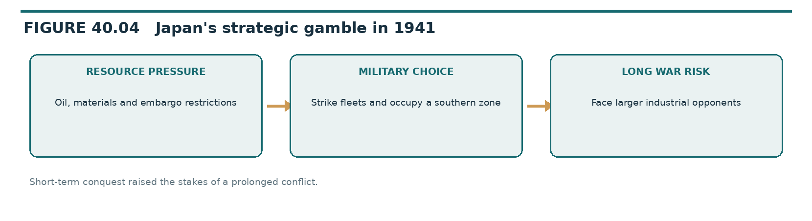

Японските стратегически организатори се опасяваха, че ограниченията върху петрола и други внос ще подкопаят военните им амбиции в Китай и Югоизточна Азия. Те решили за атаки, предназначени да неутрализират противниците, докато Япония конфискувала територии, считани за съществени за зона на имперски ресурси. На 7 декември 1941 г. японски самолет атакува американския тихоокеански флот в Пърл Харбър. Япония едновременно започна офанзиви през Югоизточна Азия и Тихия океан, включително атаки срещу британски и американски позиции. Съединените щати влязоха във войната срещу Япония, и Германия и Италия обяви война на Съединените щати дни по-късно.

Откритите японски офанзиви завладяха Малая, Сингапур, Филипините, холандските източни Индии и други територии с удивителна скорост. Военният успех разкри слабости в европейските колониални твърдения за постоянно превъзходство, но въпреки това окупацията донесе брутални последици за милиони. Япония може да спечели далечни битки без притежаване на индустриалния, гориво и военноморски капацитет, необходим за дълга война срещу Съединените щати и неговите партньори. Стратегическият дисбаланс не прави японското поражение автоматично през декември 1941 г., но създава сериозна дългосрочна уязвимост. \[<a href="/040-world-war-ii-and-the-holocaust/sources/#source-2" class="cite">2</a>\]\[<a href="/040-world-war-ii-and-the-holocaust/sources/#source-16" class="cite">16</a>\]

<figure class="figure" id="figure-40-4">

<figcaption>Фигура 40.4. Японският стратегически хазарт през 1941 г. Краткосрочното завоевание вдигна залозите на продължителен конфликт. <a class="figure-anchor" href="#figure-40-4" aria-label="Link to this figure">#</a></figcaption>
</figure>
