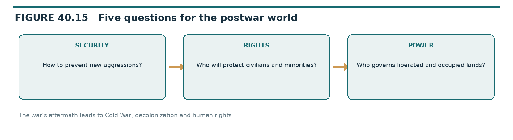

Втората световна война трябва да се разбира едновременно като война на завоевания, промишлена и логистична борба, поредица от регионални конфликти, конкурс между политическите системи и катастрофа за цивилното население. Географията му се простирала от европейските градове и източния фронт до Китай, тихоокеанските острови, Северна Африка и океаните. Холокоста илюстрира как държава с модерна бюрократична и техническа способност може да преследва геноцидни цели, докато спасяването и съпротивата показват, че човешката агенция продължава да съществува под изключителна опасност. Нито технологичната изтънченост, нито националната сила са гаранция за морална сдържаност.

Задръж пет въпроса за по-късните глави. Как международните системи могат да ограничат агресивните сили? Как политическите идеологии определят кой заслужава защита? Какво се случва, когато ресурсите на индустриална държава са организирани за пълна война? Защо различните общности помнят едни и същи събития по различен начин? Какви задължения следват, когато едно правителство е участвало в зверство? Тези въпроси водят напред към Студената война, деколонизацията, правата на човека, войната, геополитиката и изучаването на политическите институции. Краят на 1945 г. не беше краят на историята; това беше началото на ново глобално споразумение, оформено от безпрецедентни страдания и изключителни избори. \[<a href="/040-world-war-ii-and-the-holocaust/sources/#source-1" class="cite">1</a>\]\[<a href="/040-world-war-ii-and-the-holocaust/sources/#source-36" class="cite">36</a>\]

<figure class="figure" id="figure-40-15">

<figcaption>Фигура 40.15. Пет въпроса за следвоенния свят. Последиците от войната водят до Студената война, деколонизацията и човешките права. <a class="figure-anchor" href="#figure-40-15" aria-label="Link to this figure">#</a></figcaption>
</figure>
