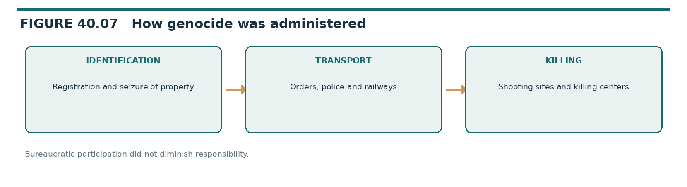

През 1942 г. лидерите на нацистите са се преместили да организират масово убийство в цяла Европа. Конференцията "Уанси" от януари 1942 г. координира политиката на немските агенции; тя не отбелязва първия момент, в който започва убийството. В центровете за убиване в окупирана Полша, сред тях са били убити хора от Чеłmno, Bełżec, Sobibór, Treblinka и Auschwitz-Birkenau. Други концентрационни лагери били използвани за лишаване от свобода, принудителен труд и убийство, но не всички били предназначени за унищожаване центрове. Точният език предотвратява историческите изкривявания.

Депортирането на влаковете, конфискацията, охраната и железопътната инфраструктура бяха инструменти за геноцид. SS ръководи системата за убиване, но участието се простира до железопътни услуги, цивилни служители, полиция и сътрудници. В същото време оцелелите избягали, някои местни хора скрили евреите въпреки изключителната опасност и мрежите за съпротива събирали информация. Масовото убийство на евреите продължило, дори когато германската военна ситуация се влошила, разкривайки, че нацистките идеологически цели биха могли да преодолеят незабавните икономически нужди във военно време. Числото шест милиона се основава на кумулативни документални и демографски доказателства, а не на буквален главен списък на всяка жертва. \[<a href="/040-world-war-ii-and-the-holocaust/sources/#source-20" class="cite">20</a>\]\[<a href="/040-world-war-ii-and-the-holocaust/sources/#source-23" class="cite">23</a>\]

<figure class="figure" id="figure-40-7">

<figcaption>Фигура 40.7. Как е бил прилаган геноцидът. Бюрократичното участие не намалява отговорността. <a class="figure-anchor" href="#figure-40-7" aria-label="Link to this figure">#</a></figcaption>
</figure>
