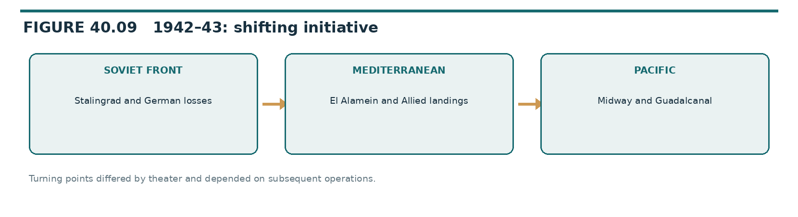

До края на 1942 г. силите на Оста са изправени пред няколко сериозни обрати. В Ел Аламейн британските сили спират предела на Оста в Египет; съюзническите кацания във Френска Северна Африка оказват допълнителен натиск. В Тихия океан Мидуей и Гуадалканал намалиха офанзивната свобода на Япония. В Съветския съюз немските сили, борещи се във и около Сталинград, стават все по- изложени на контраатака. Съветският обкръжение през ноември 1942 г. и германската капитулация в началото на 1943 г. превърна Сталинград в дълбоко военно и психологическо поражение за нацистка Германия.

Наричайки 1942 г. единична "повратна точка" риск от опростяване. Оста все още контролира огромни територии и притежава значителни армии. Съюзническите офанзиви в един театър веднага не доведоха до победа другаде. Съветските и западните лидери не бяха съгласни с откриването на голям нов фронт във Франция, а кампаниите в Италия и Средиземноморието продължиха години наред. Правилният въпрос е какво се е променило: балансът на промишлената продукция, наличността на кораби и гориво, източването на обучения персонал, сигурността на маршрутите за доставка и възможността за избор на бъдещи операции. Тези тенденции се промениха с различни скорости по целия свят. \[<a href="/040-world-war-ii-and-the-holocaust/sources/#source-3" class="cite">3</a>\]\[<a href="/040-world-war-ii-and-the-holocaust/sources/#source-17" class="cite">17</a>\]

<figure class="figure" id="figure-40-9">

<figcaption>Фигура 40.9. 43-та: преместване на инициативата. Повратните точки се различават от театъра и зависят от последващите операции. <a class="figure-anchor" href="#figure-40-9" aria-label="Link to this figure">#</a></figcaption>
</figure>
