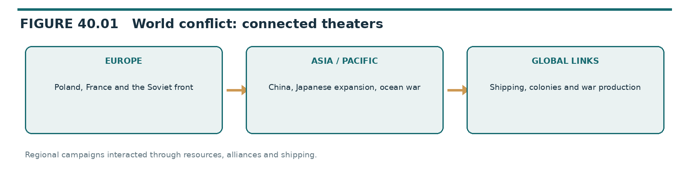

Войната става глобална не само защото войниците воюват далеч от дома си, но и защото отделни театри се засягат взаимно чрез доставки, дипломация, търговия и стратегически решения. Британската отбрана в Европа привлече войските, материалите и корабоплаването от империя, простираща се на няколко океана. Кампаниите на Япония зависели от достъпа до горива и суровини; ембаргото на САЩ и военноморската сила оформени японски планиране. Германските армии търсят съветска територия и ресурси, докато съветските военни усилия зависят от вътрешното производство и чуждестранната помощ. Един провал в морето може да изгладнее една сухоземна армия от превозни средства и да зареди на хиляди километри разстояние.

Познатото разделение в коалициите на Съюзниците и Осите е полезно, но непълно. Основните осови правомощия са Германия, Италия и Япония, като допълнителни правителства се присъединяват или си сътрудничат в различна степен. Съюзническата коалиция в крайна сметка включва Великобритания и нейните партньори от империята и Федерацията, Китай, Съветския съюз, Съединените щати, както и многобройни правителства и движения на съпротива. Членството и военните цели се променят с течение на времето. Франция претърпя окупация и разви съпернически власти; Италия смени страните си след разпадането на режима на Мусолини; България се присъедини към Оста, но промени военното си подравняване през 1944 г. Коалиционните етикети трябва да бъдат съчетани с хронология, местни интереси и действително поведение. \[<a href="/040-world-war-ii-and-the-holocaust/sources/#source-2" class="cite">2</a>\]\[<a href="/040-world-war-ii-and-the-holocaust/sources/#source-3" class="cite">3</a>\]

<figure class="figure" id="figure-40-1">

<figcaption>Фигура 40.1. Световен конфликт: свързани театри. Регионални кампании взаимодействат чрез ресурси, съюзи и корабоплаване. <a class="figure-anchor" href="#figure-40-1" aria-label="Link to this figure">#</a></figcaption>
</figure>
