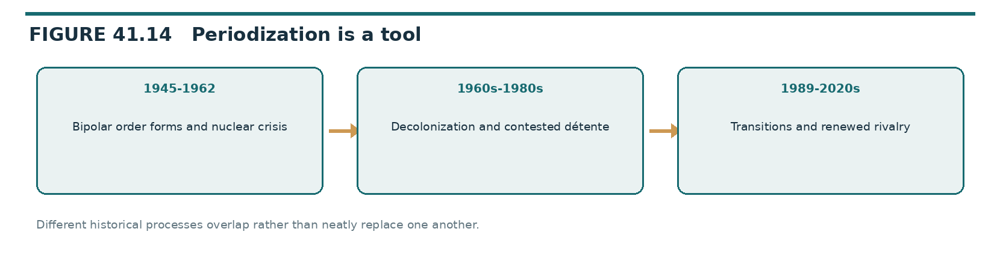

Мислете в свързани слоеве, а не в един запомнящ се списък. През 1945 г. е основана Организацията на обединените нации и военните империи започват да се изправят пред по-силни изисквания за независимост. През 1947 и 1949 г. доктрината "Труман," план "Маршал," Берлинската блокада, Индийското разделение, китайската революция и формирането на НАТО създават нови политически реалности. Корейската война започва през 1950 г.; Bandung се срещна през 1955 г.; Берлинската стена се покачи през 1961 г.; и кубинската ракетна криза от 1962 г. разкри ядрената опасност. Много африкански държави са придобили независимост през 1950 г., докато Виетнамската война се засилва и след това завършва през 1975 г.

Съветско-афганската война последва намесата от 1979 г.; реформите при Горбачов започнаха през 1985 г.; комунистическото управление рухна в Източна Европа през 1989 г.; обединението на Германия се състоя през 1990 г.; а СССР се разпадна през 1991 г. Европейският съюз започна през 1993 г., докато войните за разпадането на Югославия разтърсиха Балканите. България се присъедини към НАТО през 2004 г. и ЕС през 2007 г. По-късно кризите, включително пълномащабното нахлуване на Русия в Украйна през 2022 г., ни напомнят, че краят на биполярното съперничество не премахна териториалната война. Времевата линия е скеле; обяснението на причинно-следствената връзка е истинската образователна цел.

<figure class="figure" id="figure-41-14">

<figcaption>Фигура 41.14. Периодизацията е инструмент. Различни исторически процеси се припокриват, вместо спретнато да се заменят помежду си. <a class="figure-anchor" href="#figure-41-14" aria-label="Link to this figure">#</a></figcaption>
</figure>
