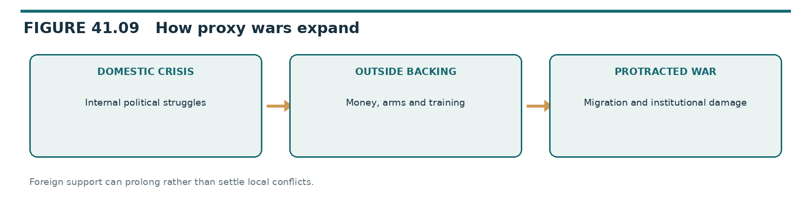

През 1979 г. Съветският съюз се намесва военно в Афганистан, за да подкрепи комунистическо правителство, което се изправя срещу широко разпространен бунт и вътрешен конфликт. Афганистанската съпротива беше разнообразна и бойците й получиха подкрепа от Пакистан, Съединените щати, Саудитска Арабия и други. Войната предизвика огромно изместване и разрушение, подкопа съветската легитимност и не успя да установи траен политически ред. Москва оттегли бойните си сили през 1989 г.; гражданската война и последващото управление на талибаните показаха, че оттеглянето от чужбина не е равносилно на мир.

Иранската революция през 1979 г. замени монархията с ислямска република, променяйки политиката в Близкия изток. Иран-Иракската война от 1980 до 1988 г. убива огромни количества и включва химически оръжия, външни оръжейни доставки и спорове за територия и регионална власт. Междувременно съветските и американски лидери възобновиха по-рязка конфронтация по време на епизоди на ядрена модернизация и регионална намеса. Затова 80-те години не бяха просто повторение на 50-те години: ислямизмът, енергийната политика, дълговите кризи и регионалните движения станаха централни части на глобалната система.

<figure class="figure" id="figure-41-9">

<figcaption>Фигура 41.9. Как прокси войните се разширяват. Чуждестранната подкрепа може да се удължи, вместо да се разрешават местни конфликти. <a class="figure-anchor" href="#figure-41-9" aria-label="Link to this figure">#</a></figcaption>
</figure>
