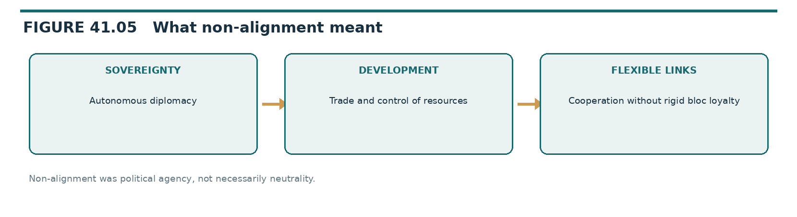

През април 1955 г. делегати от двадесет и девет азиатски и африкански правителства се срещнаха в Бандунг в Индонезия, за да обсъдят мира, суверенитета, расизма, развитието и противопоставянето на колониализма. Конференцията не създаде нито един единен блок и нейните участници често не се съгласиха остро. Въпреки това той сигнализира, че наскоро независимите държави няма непременно да определят избора си чрез приоритетите на Вашингтон и Москва. Неподправеното движение е официално основано през 1961 г. с лидери, включително Тито, Неру, Насер, Сукарно и Нкрума, свързани с произхода му.

Неподчинението не означава неутралитет по всеки въпрос или отказ от всякаква суперсила помощ. Страните могат да получат помощ, да купуват оръжия и да се оспорват взаимно, докато търсят място за маневриране. Терминът "трети свят" първоначално е имал политическо значение в този контекст, въпреки че по-късната му употреба като стенография за бедността скрива разнообразието на участващите страни. Суверенността също беше икономически въпрос: кой контролира петрола, мините, търговските маршрути, финансите за дълг и развитие? Търсенето на нов международен икономически ред през 70-те години на миналия век е нараснало от тези спорове.

<figure class="figure" id="figure-41-5">

<figcaption>Фигура 41.5. Какво означаваше не-подравняване. Неподчинението е било политическа агенция, а не непременно неутралитет. <a class="figure-anchor" href="#figure-41-5" aria-label="Link to this figure">#</a></figcaption>
</figure>
