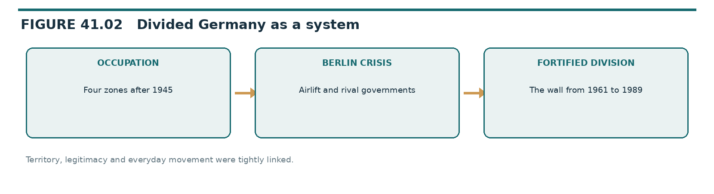

Следвоенна Германия първоначално е била управлявана чрез окупационни зони. През 1948 г. съветските власти блокираха достъпа на повечето земи до западните сектори на Берлин, които се намираха в съветската окупационна зона. Западните съюзници отговориха с обширен въздушен лифт, вместо да изоставят града или да се опитат да направят военен пробив. Блокадата приключи през 1949 г. След това се появяват две германски държави: Федерална република Германия на запад и Германската демократична република на изток, всяка от които е вградена в по-голяма структура на съюза.

НАТО е сформирана през 1949 г. като съюз за колективна защита; Варшавският пакт следва през 1955 г. под съветското ръководство. Това не бяха перфектни огледални образи: характерът на вземането на решения, вътрешния суверенитет и третирането на несъгласието между държавите-членки се различаваха. През 1961 г. източногерманските власти издигнаха Берлинската стена, за да спре емиграцията и да контролира движението, превръщайки Берлин в мощен символ на европейската политическа география. Военното възпиране, икономическата интеграция и легитимността у дома станаха част от същия конкурс.

<figure class="figure" id="figure-41-2">

<figcaption>Фигура 41.2. Разделил Германия като система. Територията, легитимността и ежедневното движение бяха тясно свързани. <a class="figure-anchor" href="#figure-41-2" aria-label="Link to this figure">#</a></figcaption>
</figure>
