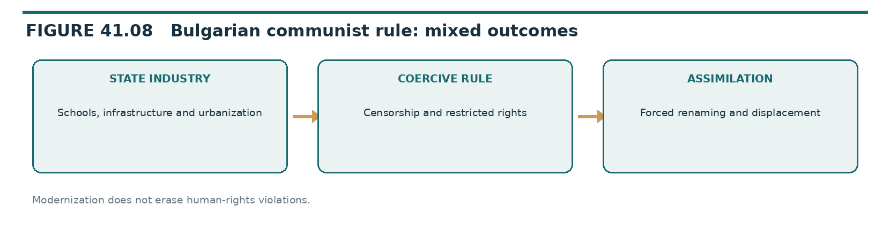

През 80-те години българските комунистически власти засилиха принудителните политики към турски и други мюсюлмански общности. По време на т.нар. "възраждащ се процес" много хора бяха принудени да заменят имената си и бяха изправени пред ограничения върху езика, религиозната практика и културния израз. Съпротивата доведе до задържане и насилие. През 1989 г. режимът оказва натиск и дава възможност за отпътуването на голям брой български турци в Турция - епизод, често описван като "Голямото екскурзия" в официалния евфемизъм, но разследван от учени като насилствено изместване и етническо прочистване.

Тази история не трябва да се представя като обикновена доброволна миграция или като безобидна политика за модернизация. Също така не бива да се предполага, че всички българи са подкрепили кампанията; съществуваше опозиция, страх и различен местен опит. Обосновката на режима се основаваше на твърдения за национална идентичност и асимилация, които отказаха на гражданите правото да определят своята културна принадлежност. Политиката беше официално отменена след отстраняването на Тодор Живков от власт през ноември 1989 г. Последиците от нея остават важни за правата на малцинствата, историческата памет, доверието в институциите и отношенията на България с Турция.

<figure class="figure" id="figure-41-8">

<figcaption>Фигура 41.8. Българското комунистическо управление: смесени резултати. Модернизацията не заличава нарушенията на човешките права. <a class="figure-anchor" href="#figure-41-8" aria-label="Link to this figure">#</a></figcaption>
</figure>
