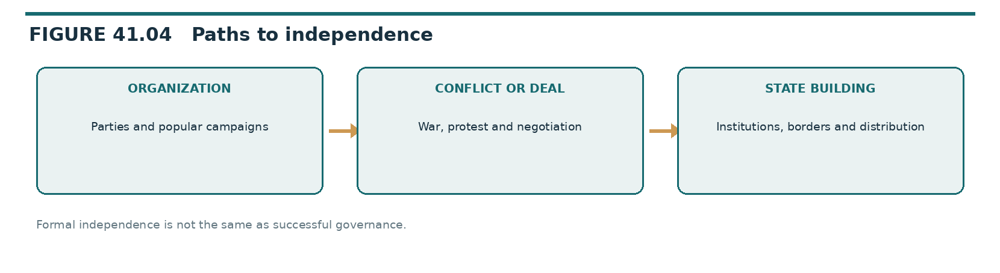

През 1945 г. стотици милиони хора живеели под колониално управление. Колониалните поданици служили в световните войни, произвеждали основни доставки и изграждали политически организации, които изисквали равни права или суверенитет. Преумората в Европа отслаби императорския контрол, докато новите международни принципи направиха колониалното управление все по-трудно да се оправдае. Независимостта обаче не била дар, предоставен от Вашингтон или Москва. Африка, азиатските, карибските и тихоокеанските движения преговаряха, организираха стачки, водеха войни, разискваха конституции и развиха конкурентни видения за бъдещето си.

Организацията на обединените нации стана важен форум, особено чрез декларацията си от 1960 г. относно предоставянето на независимост на колониалните страни и народи. ООН съобщава, че повече от осемдесет бивши колонии са придобили независимост след създаването си. Тези цифри описват огромна политическа трансформация, но не и универсален процес: бившите зависимости са имали различен правен статут и няколко територии остават в списъка на ООН на териториите, които не се управляват самостоятелно. Независимостта не осигурява автоматично преразпределение на земите, икономическо равенство, работещи администрации или сигурни национални граници. Новите държави наследиха разнообразни образователни системи, експортни икономики и понякога спорни граници.

<figure class="figure" id="figure-41-4">

<figcaption>Фигура 41.4. Пътища към независимостта. Формалната независимост не е същата като успешното управление. <a class="figure-anchor" href="#figure-41-4" aria-label="Link to this figure">#</a></figcaption>
</figure>
