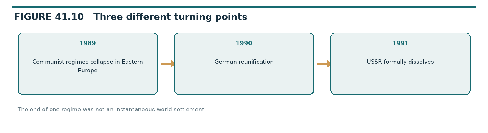

Германия отново се събра на 3 октомври 1990 г. след дипломатическите преговори между двете германски държави и четирите правомощия, които са заемали права след войната. Процесът изискваше решения за членство в съюза, граници, валута, публична собственост и съдбата на бивши източногермански институции. За много граждани обединението означаваше нови права и възможности; за други това означаваше също безработица, дислокация и трудно предоговаряне на идентичността. Берлинската стена може да бъде премахната по-бързо от различията между две отдавна разделени икономики.

В рамките на Съветския съюз републиканските националистически движения, фискални проблеми, елитни борби и реформи подкопават централната власт. Проваленият консервативен преврат през август 1991 г. допълнително отслаби съюза. До декември 1991 г. СССР се разпуска и съставните му републики стават независими държави. Събитието не означаваше, че руската сила, ядрени оръжия, геополитически интереси или етнически и териториални спорове са изчезнали. Разликата между прекратяването на идеологическия блок и създаването на мирен международен ред е от основно значение за следващите десетилетия.

<figure class="figure" id="figure-41-10">

<figcaption>Фигура 41.10. Три различни повратни точки. Краят на един режим не беше мигновено световно селище. <a class="figure-anchor" href="#figure-41-10" aria-label="Link to this figure">#</a></figcaption>
</figure>
