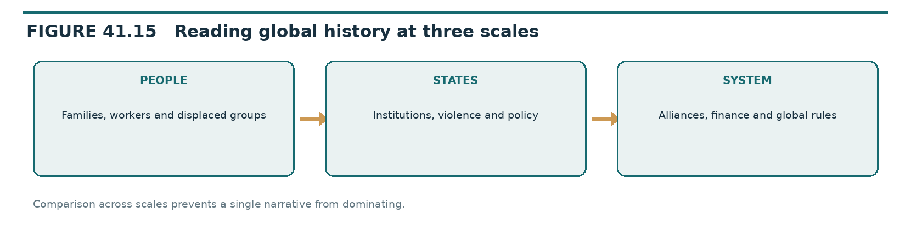

Три подхода помагат да се предотврати изкривяване. Първо, промени мащаба. Дипломатът може да види един договор като успешен; изселено семейство може да си спомни една незавършена война; работник от фабриката може да опише технологичния напредък и безработицата в същия живот. Второ, сравнявайте политическите проекти с резултати, вместо да съдите обществата само по посочени идеали. Трето, разгледайте институциите. Обещанието на революцията за равенство има значение, но също и изборните закони, полицейските правомощия, поземлените регистри, търговските договорености и училищата, които оформят всекидневния опит.

И накрая, помнете, че историческото обяснение не е морална равностойност. Насилието на държавата, принудителната асимилация, расовата дискриминация, демократичното участие и хуманитарното сътрудничество следва да бъдат описани с подходящи доказателства и етична яснота. Двадесети век след 1945 г. не бил нито един прост поход към свободата, нито едно непрекъснато спускане в конфликт. Това беше ера на изключителна човешка агенция, успех, провал и недовършени аргументи за това кой управлява, кой печели и какво прави международния ред законен. Това е мостът в следващите глави на геополитиката.

<figure class="figure" id="figure-41-15">

<figcaption>Фигура 41.15. Четене на глобална история по три кантара. Сравнението между везните пречи на един разказ да доминира. <a class="figure-anchor" href="#figure-41-15" aria-label="Link to this figure">#</a></figcaption>
</figure>
