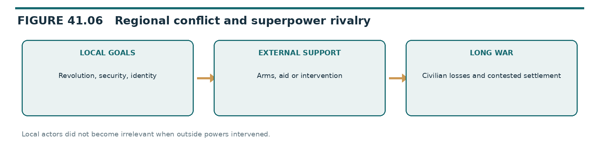

В Близкия изток краят на военновременните мандати, еврейските и арабските националистически движения, приходите от нефт и конкуренцията сред регионалните правителства формират следвоенната политика. Основаването на Израел през 1948 г. следва плана на ООН за разделяне, гражданския конфликт в задължителна Палестина и регионалната война; палестинците са имали масово изместване и диспозитив, известен като Накба. Това установи въпроси, свързани с бежанците, границите, сигурността и политическите права, които ще останат нерешени през по-късните войни. Суецката криза от 1956 г. показа, че Великобритания и Франция вече не могат просто да наложат волята си на Египет, без да се изправят пред натиска на САЩ и Съветския съюз.

Египетският президент Гамал Абдел Насер насърчава арабския национализъм и държавното развитие; други правителства следват монархични, републикански, социалистически или ислямистки пътища. Иранската политика включва свалянето на премиера Mohammad Mosaddegh през 1953 г. след борбите за национализация на петрола, с участието на британците и американските граждани, както и революцията от 1979 г., която създава Ислямска република. През 70-те години на миналия век шокът от цените на петрола разкри как производителите и потребителите зависят един от друг. Регионалните конфликти имали свои истории дори когато суперсилите осигурявали оръжия и дипломатическа подкрепа.

<figure class="figure" id="figure-41-6">

<figcaption>Фигура 41.6. Регионален конфликт и съперничество със суперсили. Местните актьори не станаха без значение, когато се намесиха външни сили. <a class="figure-anchor" href="#figure-41-6" aria-label="Link to this figure">#</a></figcaption>
</figure>
