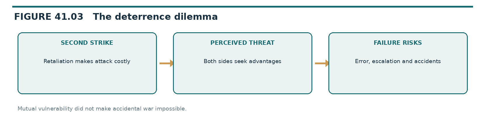

Атомните оръжия трансформираха стратегически изчисления. Съединените щати са използвали атомни бомби през 1945 г.; Съветският съюз тества първото си атомно устройство през 1949 г. Водородни бомби, бомбардировачи с голям обсег, балистични ракети и системи за изстрелване на подводници по-късно дадоха възможност и на двете страни за катастрофално унищожение. Детеренцията зависеше от убеждаването на противника, че атаката ще предизвика неприемливо отмъщение. Достоверна възможност за втори удар може да обезкуражи първия удар, но също така изисква опасни разгръщания и сложни командни договорености.

Взаимно гарантираното унищожение често се използва като гаранция за мир. Не е вярно. Инцидентите, погрешните предупреждения, неоторизираните изстрели, погрешните схващания и ескалирането по време на конвенционалните кризи остават сериозни опасности. Правителствата, инвестирани в мрежи за ранно предупреждение, закоравели комуникации, проверка на контрола на оръжията и кризисни процедури за намаляване на несигурността. Централният парадокс на ядрената стратегия е, че усилията да станем по-сигурни могат да увеличат страха и от двете страни. Липсата на ядрена война е резултат, оформен от сдържаност, институции и късмет, а не доказателство, че ядрените оръжия създават безрискова международна система.

<figure class="figure" id="figure-41-3">

<figcaption>Фигура 41.3. Дилемата на възпирането. Взаимната уязвимост не направи случайната война невъзможна. <a class="figure-anchor" href="#figure-41-3" aria-label="Link to this figure">#</a></figcaption>
</figure>
