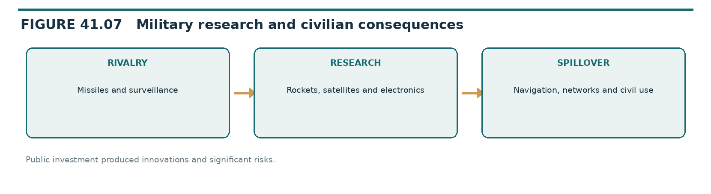

Състезанието между суперсилите финансира ядрени оръжия, ракети, сателити, компютри, радари и специализирани изследвания. Съветският старт на Спутник през 1957 г. и орбиталният полет на Юри Гагарин през 1961 г. повишиха статута на съветската наука; американският Аполо 11 кацане през 1969 г. стана емблема на американския технологичен и организационен капацитет. Университети, изпълнители и военни лаборатории формират мрежи, чиито изобретения по-късно влияят на гражданските комуникации, медицината и електрониката.

Научното постижение не може да бъде отделено от политическите институции и човешките разходи. Ядрените тестове излагаха общностите на радиация, военните изследвания се конкурираха с други бюджетни нужди, а публичната информация често беше класифицирана. Гражданите бяха привлечени и в идеологическите спектакли: учениците се научиха на обучение за гражданска защита, атлетичните медали станаха символични победи, а художествените турове рекламираха националната култура. Урокът не е в това, че технологиите са само пропаганда; именно иновациите изискват институции, образование, капитал и социални избори. Научният напредък може да подобри ежедневния живот, докато остава вграден във военната конкуренция.

<figure class="figure" id="figure-41-7">

<figcaption>Фигура 41.7. Военни изследвания и цивилни последствия. Публичните инвестиции произвеждат иновации и значителни рискове. <a class="figure-anchor" href="#figure-41-7" aria-label="Link to this figure">#</a></figcaption>
</figure>
