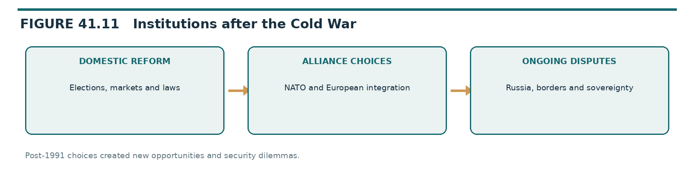

Европейската интеграция се ускори след Студената война. Договорът от Маастрихт, подписан през 1992 г. и пораждащ действие през 1993 г., създаде Европейския съюз и положи основите за по-дълбоко политическо и парично сътрудничество. По-късно ЕС се разшири, за да включи много бивши комунистически държави. НАТО също се разшири на изток, тъй като новите демокрации потърсиха гаранции за сигурност, докато руските лидери все повече третираха разширяването като заплаха. Тези конкурентни позиции помагат да се обяснят по-късно дипломатическите спорове, без да се предполага, че на държавите им липсва агенция за търсене на съюзи или че всеки следващ конфликт е неизбежен.

България се присъедини към НАТО през 2004 г. и Европейския съюз през 2007 г., като получи достъп до общи институции и пазари, като прие споделени ангажименти. Страната продължи да се изправя пред вътрешни предизвикателства, свързани с управлението, регионалните различия и демографските промени. Интеграцията може да разшири възможностите без прекратяване на националното вземане на решения или уреждане на всички политически разногласия. За сравнение в исторически план, разграничете защо отделните държави са кандидатствали за членство, как съществуващите членове са преговаряли за разширяване и какви последствия са последвали в различни периоди.

<figure class="figure" id="figure-41-11">

<figcaption>Фигура 41.11. Институция след Студената война. Пост-1991 избор създаде нови възможности и дилеми за сигурност. <a class="figure-anchor" href="#figure-41-11" aria-label="Link to this figure">#</a></figcaption>
</figure>
