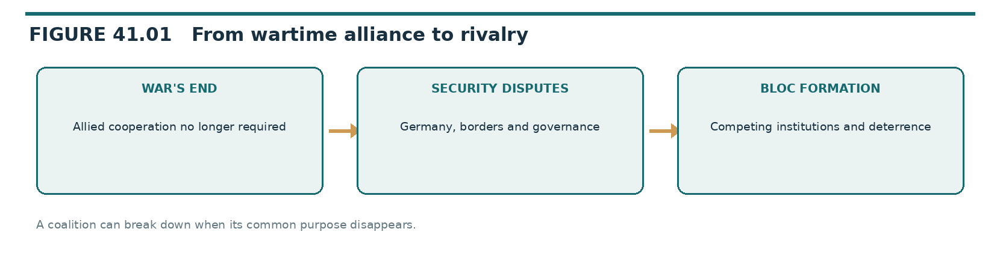

През 1945 г. Съединените щати притежават несравним индустриален капацитет, световни военни бази и единствените разположени атомни оръжия. Съветският съюз се появи победител, но опустошен от борбата и масовата смърт; неговите сили окупираха голяма част от Централна и Източна Европа. Британия и Франция запазили световното си имущество, но се сблъскали с финансови и политически изтощение. Китай е издържал дълга война с Япония и отново е разделен от граждански конфликт. Много общества в Азия и Африка очакваха военновременни обещания за свобода и самоопределение да се прилагат отвъд Европа.

Военната коалиция сътрудничи срещу нацистка Германия въпреки дълбоките разногласия относно политическите институции и сигурността. С изчезването на този общ враг членовете му тълкуваха по различен начин немските реконструкции, полските граници, изборите и бъдещето на окупираните територии. Съветските лидери потърсиха сигурност срещу друго западно нашествие и техните методи създадоха несигурност за страните, подложени на контрола на Москва. Американските лидери се страхуваха от разширяване на съветско подкрепяните комунистически режими, дори когато техните съюзи често включваха колониални сили и авторитарни правителства. Разработена дилема за сигурност: стъпки от едната страна, наречени "отбрана," могат да изглеждат обидни на другата. Разбирането на това не прави принудата и доброволния съюз идентични.

<figure class="figure" id="figure-41-1">

<figcaption>Фигура 41.1. От военен съюз до съперничество. Коалицията може да се разпадне, когато общата й цел изчезне. <a class="figure-anchor" href="#figure-41-1" aria-label="Link to this figure">#</a></figcaption>
</figure>
