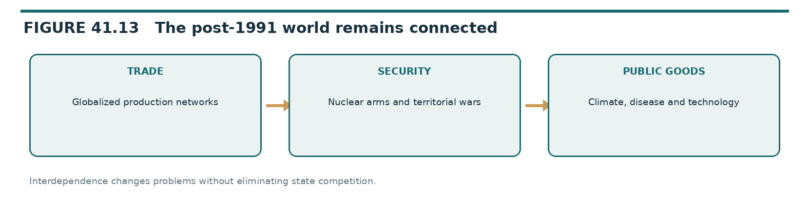

До 1991 г. европейската колониална карта е била фундаментално трансформирана, ръководеният от СССР блок се е срутил, Германия е обединена и Съединените щати заемат необичайно мощна международна позиция. Международните институции бяха по-обширни, отколкото през 1945 г., а глобалните търговски и научни мрежи се разширяваха. И все пак политическата независимост не гарантира икономическа автономия; ядрените арсенали оцеляха; границите и историческите оплаквания останаха спорни; и авторитарната власт не изчезна със съветския комунизъм.

Най-дълбокият урок е, че историческите периоди се припокриват. Деколонизацията не просто приключи, когато Студената война свърши, а институциите от Студената война продължиха да оформят системата след 1991 г. Една страна може да стане независима, да остане икономически зависима и все още да упражнява творческа дипломатическа агенция. Обществото може да стане по-богато, докато някои граждани губят политически права. Тази глава завършва хронологичното проучване на книгата, подготвяйки ни да анализираме повтарящи се структури, вместо да повтаряме линейната времева линия. В част IV ще разгледаме механизмите зад войната, мира, сигурността, географията и международната власт, като използваме историята от 1945 г. и след това като доказателство, а не като покана за лесна сигурност.

<figure class="figure" id="figure-41-13">

<figcaption>Фигура 41.13. Светът след 1991 г. остава свързан. Междузависимостта променя проблемите, без да елиминира държавната конкуренция. <a class="figure-anchor" href="#figure-41-13" aria-label="Link to this figure">#</a></figcaption>
</figure>
