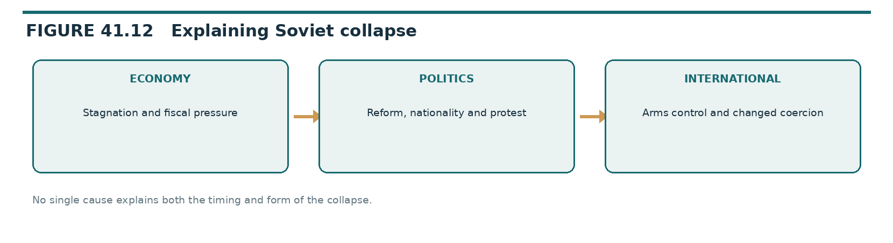

Историците не са съгласни с относителното значение на икономическата стагнация, военните разходи, гражданската съпротива, съветската реформа, западния натиск, национализма и информационната среда за прекратяване на Студената война. Няколко обяснения могат да бъдат отчасти верни, без да са взаимозаменяеми. Доказателствата за правителствените финанси не могат да обяснят само момента на отварянето на мирната граница; доказателствата за изказванията на политически лидер не могат да обяснят само колапса на многонационална държава. Добрият исторически анализ пита какво се е променило, чрез кои механизми и защо събитията са се ускорили през 1989 г., а не през по-ранното десетилетие.

Да разгледаме два варианта. Ако съветските лидери бяха избрали да нахлуят отново в съседните държави през 1989 г., преходите можеха да бъдат по-кървави и по-бавни. Ако реформите не бяха оспорили икономическото планиране и партийната привилегия, системата можеше да остане по-стабилна за известно време, но все пак можеше да се изправи пред дълбоки проблеми с легитимността. Противоречията не са факти за алтернативни истории; те са тестове на причинно-следствената логика. Тяхната стойност е да определят кои фактори изглеждат необходими или важни, а не да се преструват, че знаят точно какво щеше да се случи.

<figure class="figure" id="figure-41-12">

<figcaption>Фигура 41.12. Обяснявам рухването на Съветския съюз. Нито една причина не обяснява времето и формата на колапса. <a class="figure-anchor" href="#figure-41-12" aria-label="Link to this figure">#</a></figcaption>
</figure>
