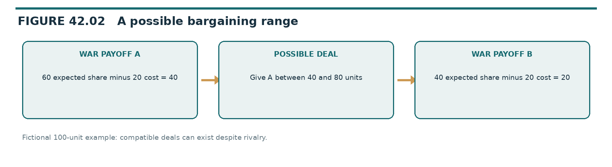

Представете си спорен актив на стойност 100 единици за страните заедно. Държава А смята, че има 60% шанс да получи актива чрез война и очаква да загуби 20 единици в борбата. Очакваното изплащане от войната е 60 минус 20, или 40. Страната B очаква да задържи 40 процента и също така ще загуби 20, като му се даде очаквано изплащане от 20. Договорено деление, което дава А между 40 и 80 единици и дава на Б остатъка, ще остави както настрана, така и очакванията им от войната. Този интервал е диапазонът на договаряне. Цифрите са хипотетични и не са оценки за исторически конфликт.

Обърни внимание на чувствителността на резултата към вярванията. Ако Country A мисли, че победата е почти гарантирана, докато Country B вярва същото за себе си, всеки може да поиска дял твърде голям, за да приеме другия. Ако стойността на актива се промени, защото контролира водата, нефта или жизненоважната военна позиция, споразумението може да бъде по-трудно. Ако един договор не може да бъде изпълнен, сделка, която изглежда привлекателна днес, може да изглежда съсипана утре. Математически модел не намалява човешкия живот до числа; той прави нашите предположения видими, така че неясно обяснение като "войната е неизбежна" могат да бъдат разгледани по-внимателно.

<figure class="figure" id="figure-42-2">

<figcaption>Фигура 42.2. Възможно е да има пазарлъци. Измислен пример за 100-единици: съвместими сделки могат да съществуват въпреки съперничеството. <a class="figure-anchor" href="#figure-42-2" aria-label="Link to this figure">#</a></figcaption>
</figure>
