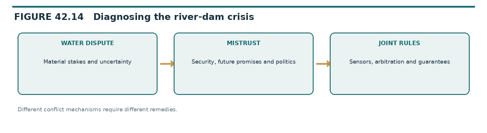

Представете си два щата, които споделят река. Държава А строи язовир нагоре по течението, твърдейки, че се нуждае от електричество и защита от наводнения. Страната B се страхува, че изпусканията на вода могат да опустошат фермите й и да разглеждат язовира като потенциално оръжие. Военните патрули се увеличават близо до границата. Президентът на А обещава да не нарушава водния поток, но Б не вярва на обещанието, защото правителството на А може да се промени. Местните партии в двете страни наричат преговорите капитулация. Този учебен сценарий е измислен, проектиран да съчетава няколко механизма, въведени в главата.

Сега диагностицирайте случая на слоеве. Материалният спор се отнася до водата и електричеството; дилемата на сигурността възниква, защото защитната инфраструктура изглежда заплашителна; проблемът с ангажимента засяга бъдещото управление на язовирната стена; вътрешната политика прави компромиса опасен за лидерите; непълни хидрологични данни създават информационен проблем. Възможните средства включват съвместна речна комисия, сензори, достъпни и за двете страни, обвързващ график за освобождаване на водата, независим арбитраж и спешни комуникации. Никой не гарантира мир, но всяка цел е специфичен механизъм. Силната диагноза трябва да направи разграничение между предотвратяването на избухването на насилие от изграждането на договорености, които остават надеждни след това.

<figure class="figure" id="figure-42-14">

<figcaption>Фигура 42.14. Диагностицирам кризата с реката. Различните механизми за конфликт изискват различни средства за защита. <a class="figure-anchor" href="#figure-42-14" aria-label="Link to this figure">#</a></figcaption>
</figure>
