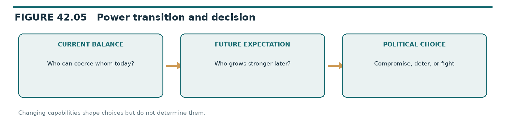

Някои теории подчертават разпределението на властта в международната система. Една доминираща сила може да се опита да попречи на претендентите да растат, докато една изгряваща държава може да търси промени в правилата и границите, които смята за несправедливи. Преходните периоди могат да бъдат особено опасни, ако и двете страни очакват бъдещият баланс да се различава рязко от настоящия. Въпреки това, нарастващата сила не е универсална причина за война. Историческите случаи включват мирни жилища, скъпи оставки и войни и те се различават в институциите, географията и намеренията. \[<a href="/042-why-wars-begin/sources/#source-2" class="cite">2</a>\]

Броят на големите сили, понякога описани като биполярност, многополюсност или еднополярност, могат да повлияят на стратегическите изчисления, без да се определят резултатите. Многополюсната система дава на държавите няколко потенциални партньори, но може да създаде несигурност по отношение на ангажиментите; двуполюсният конкурс концентрира конкуренцията, но може да насърчи предпазливото възпиране. Няма проста формула предвижда война от броя на големите сили. Лидерите трябва да изберат как да реагират на системния натиск, а местните и личните фактори често помагат да се обясни защо очевидно подобни промени в мощността водят до различни резултати.

<figure class="figure" id="figure-42-5">

<figcaption>Фигура 42.5. Мощен преход и решение. Промяна на възможностите форма избор, но не ги определят. <a class="figure-anchor" href="#figure-42-5" aria-label="Link to this figure">#</a></figcaption>
</figure>
