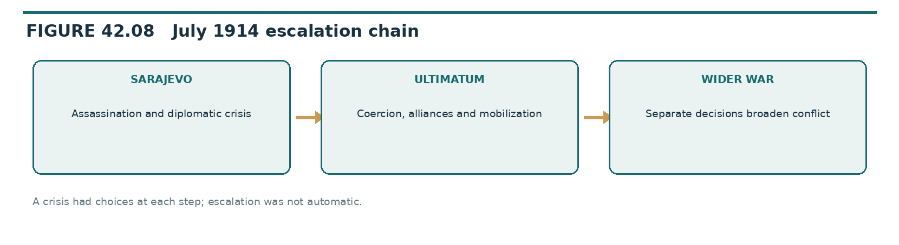

Убийството на ерцхерцог Франц Фердинанд в Сараево на 28 юни 1914 г. започва дипломатическа криза сред правителствата, вече разделени от имперски съперници, балкански национализъм и военна конкуренция. Австрия-Унгария се опита да накаже Сърбия и получи германска подкрепа. Русия не искаше да приеме сръбското поражение или появата на изоставяне. Съюзът на Франция с Русия и стратегическите проблеми на Великобритания разшириха кризата. Австрийският ултиматум, сръбският отговор, решенията за мобилизация и германското военно планиране имаха значение при разпознаваеми стъпки. Последователността е контингент: много по-ранни кризи са приключили без обща европейска война. \[<a href="/042-why-wars-begin/sources/#source-12" class="cite">12</a>\]

Няколко механизма взаимодействаха. Лидерите погрешно се прецениха взаимно за готовността си да се борят; Виена и Берлин се надяваха, че ограничената принуда може да успее; военните графици създадоха натиск; и изместването на възприятията за руската власт засегна стратегическите очаквания. И все пак партиите не са еднакво отговорни за всяко решение и историците обсъждат относителната тежест на избора на всяко правителство. Интерпретацията на сигурността може да озари страха, без да замени доказателства за агресивна политика. За да се поучите от 1914 г., изградете времева линия на решенията и попитайте какво всеки капитал знае и все още може да избира на всеки етап.

<figure class="figure" id="figure-42-8">

<figcaption>Фигура 42.8. Юли 1914 ескалация верига. Кризата имаше избор на всяка стъпка; ескалацията не беше автоматична. <a class="figure-anchor" href="#figure-42-8" aria-label="Link to this figure">#</a></figcaption>
</figure>
