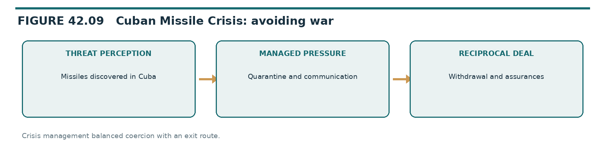

През октомври 1962 г. Съединените щати откриват, че съветските ядрени ракети са инсталирани в Куба. Американските лидери ги тълкуваха като основно стратегическо и политическо предизвикателство; съветските лидери се опитваха да подобрят сигурността на Куба и да променят ядрения баланс, поемайки сериозен риск. Администрацията на Кенеди отхвърли някои незабавни военни възможности и наложи военноморска карантина. Комуникации на високо равнище, частно договаряне и желание за премахване на ракети при договорени условия помогнаха да се предотврати пряка американска война. \[<a href="/042-why-wars-begin/sources/#source-14" class="cite">14</a>\]

Кризата показва възможността и крехкостта на сдържаността под изключителна опасност. Съобщенията бяха забавени или неясни, местните командири бяха изправени пред напрегнати срещи и не всички участници контролираха всяко оръжие или разполагане. Частично споразумение включваше изтеглянето на съветски ракети от Куба и американските уверения да не нахлуват на острова, заедно с отделно разбиране относно американските ракети в Турция. Историците спорят колко близо е светът до ядрена война, но случаят ясно илюстрира защо надеждната комуникация, контролът на силите и споразуменията за спасяване на лица могат да имат значение, когато лидерите нямат достатъчно време да решат.

<figure class="figure" id="figure-42-9">

<figcaption>Фигура 42.9. Кубинска ракетна криза: избягване на война. Управление на кризи балансирана принуда с изходен маршрут. <a class="figure-anchor" href="#figure-42-9" aria-label="Link to this figure">#</a></figcaption>
</figure>
