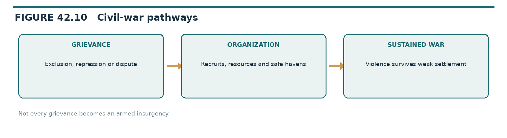

Гражданската война включва организиран въоръжен конфликт в една държава, въпреки че съседните правителства и международни покровители могат да се намесват. Страните могат да оспорват централното правителство, регионалната автономия, земята, ресурсите или оцеляването на дадена общност. Гражданските войни могат да започнат чрез провалени политически селища, преврати, репресии, отцепнически движения или нарушаване на държавната власт. Изследователите обсъждат колко етническо разделение, бедност, география, политическо изключване и слаби институции увеличават рисковете. Няма надеждно правило, че различните общества са естествено предназначени за насилие. \[<a href="/042-why-wars-begin/sources/#source-17" class="cite">17</a>\]

Набезите са по-лесни за поддържане в някои среди от други. Планините и горите могат да усложни правителствения контрол; порестите граници позволяват доставки и убежище; административната слабост може да създаде отвори за въоръжени организации. Но военната възможност сама по себе си не ни казва защо хората се присъединяват към едно движение. Страхът, идеологията, местната несправедливост, принуда, родство, безработица и стратегии за оцеляване могат да повлияят на участието. За разбирането на гражданските войни е важно да се питаме кой организира насилието, кой го финансира, как се третират цивилните граждани и кои публични институции остават в състояние да уреждат споровете мирно.

<figure class="figure" id="figure-42-10">

<figcaption>Фигура 42.10. Пътища от гражданска война. Не всяко оплакване се превръща във въоръжен бунт. <a class="figure-anchor" href="#figure-42-10" aria-label="Link to this figure">#</a></figcaption>
</figure>
