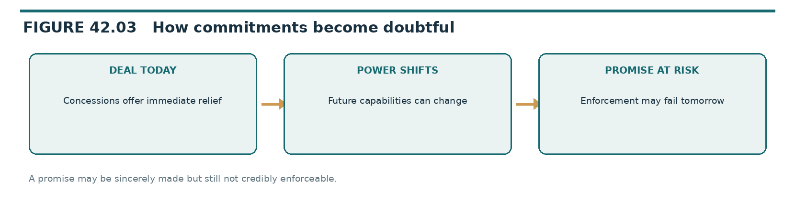

Да предположим, че силна държава се съгласи да не атакува по-слаб съсед в замяна на оттегляне. Десет години по-късно по-слабата държава очаква да стане много по-силна чрез растежа на населението, нови съюзи или технологии. Силното състояние може да се страхува, че днешното обещание повече няма да ограничава съседа си, когато балансът се промени. По подобен начин едно демобилизирано бунтовническо движение може да се страхува от затвор или клане, след като предаде оръжията си. И двата случая повдигат проблем с обвързването: предложеното споразумение разпределя властта сега, но няма надежден механизъм, който да гарантира, че страните ще я спазват при промяна на стимулите. \[<a href="/042-why-wars-begin/sources/#source-5" class="cite">5</a>\]

Проблемът с обвързването се различава от обикновеното лъжене. Лидерите могат искрено да обещаят мир и все още не успяват да убедят противниците си, защото наследниците или бъдещите обстоятелства могат да премахнат намеренията си. Ето защо споделянето на властта, демилитаризираните зони, гаранциите от трети страни и международния мониторинг могат да имат значение. Но външните гаранти имат ограничени ресурси и променящи се приоритети и те не могат автоматично да гарантират спазването им. Предложеният мир трябва да бъде оценен не само с това, което обещава, но и с начина, по който ще бъдат открити, наказани и отстранени нарушенията.

<figure class="figure" id="figure-42-3">

<figcaption>Фигура 42.3. Как ангажиментите стават съмнителни. Обещанието може да бъде искрено дадено, но все още не е много изпълнимо. <a class="figure-anchor" href="#figure-42-3" aria-label="Link to this figure">#</a></figcaption>
</figure>
