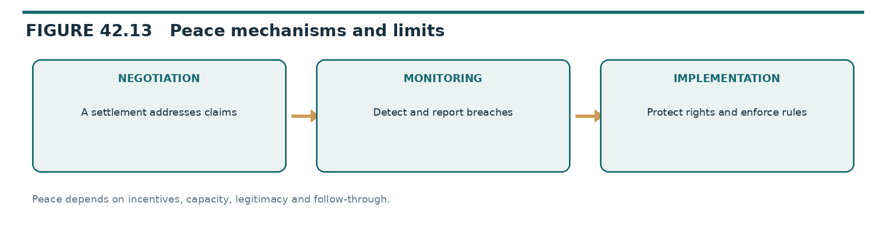

Дипломацията осигурява алтернативи на военната конфронтация, но това не е магическа дума. Посредничеството може да помогне на страните да идентифицират взаимно приемливите условия; арбитражът и съдебното решение могат да разрешат някои правни спорове; наблюдението на прекратяването на огъня може да разкрие нарушения; мироопазването може да създаде пространство за политическо уреждане. Други инструменти включват включване на изборите, надеждна защита на правата на малцинствата, справедливо полицейско управление, антикорупционна реформа и икономически договорености, които правят възобновеното насилие по-малко привлекателно. Организацията на обединените нации се отнася към превенцията като към комбинация от политически, сигурност, човешки права и усилия за развитие, а не към една последна среща. \[<a href="/042-why-wars-begin/sources/#source-21" class="cite">21</a>\]

Всяка мярка има ограничения. Санкциите могат да наранят цивилни граждани и понякога да засилят управляващата коалиция; мироопазващите сили може да нямат мандати или ресурси; посредничеството може да възнагради въоръжени лица, като изключим жертвите; конституционните сделки могат да станат кухи без ефективни съдилища и администрация. Прекратяването на огъня може да спре стрелбата без решаване на спора за територия или политическа власт. Отговорният анализ определя каква е целта на предложената намеса за промяна, кой трябва да я приложи, кой може да я развали и как ще бъде оценяван успехът. Краят на бойните смъртни случаи е спешно постижение, но траен мир изисква по-дълъг институционален процес.

<figure class="figure" id="figure-42-13">

<figcaption>Фигура 42.13. механизми и ограничения за мир. Мирът зависи от стимули, капацитет, легитимност и последващи действия. <a class="figure-anchor" href="#figure-42-13" aria-label="Link to this figure">#</a></figcaption>
</figure>
