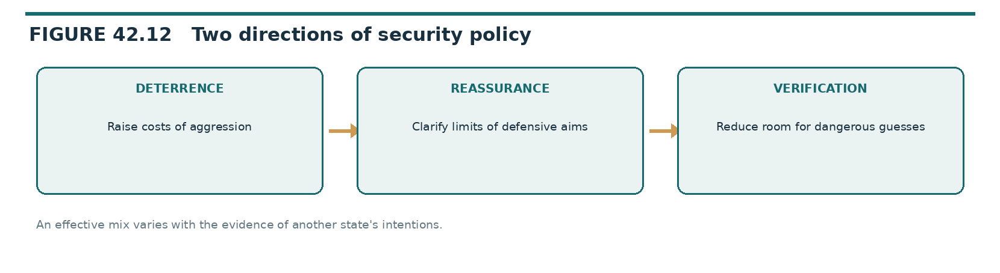

Deterrence се стреми да попречи на противника да избере сила, като направи очакваните разходи за агресия твърде високи. Верен отбранителен съюз, способни въоръжени сили и обществена ангажираност могат да обезкуражат атаката. Но възпирането действа чрез възприятия, а не просто притежаване на оръжия. Ако лидерите не са разбрали правилно предупреждението или вярват, че защитникът няма да спази обещанието си, военната сила може да не успее да предотврати войната. Усилията за подобряване на доверието също могат да изглеждат заплашителни, влошавайки една дилема за сигурност.

Преустановяването работи в друга посока: правителствата съобщават, че техните защитни мерки не са подготовка за завоевание. Споразуменията за контрол на оръжията, инспекциите, военните горещи линии, изричните червени линии, взаимното оттегляне и комуникацията при кризи могат да намалят двусмислието. Правилният баланс зависи от ситуацията. Устойчивостта на една наистина агресивна държава може да насърчи по - нататъшното принуда; заплашителната позиция спрямо основно отбранителна държава може да задълбочи страха ѝ. Успешната политика изисква доказателства за намеренията и адаптивността, когато тези оценки се окажат погрешни.

<figure class="figure" id="figure-42-12">

<figcaption>Фигура 42.12. Две посоки на политиката за сигурност. Един ефективен микс варира в зависимост от доказателствата за намеренията на друга държава. <a class="figure-anchor" href="#figure-42-12" aria-label="Link to this figure">#</a></figcaption>
</figure>
